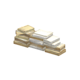
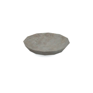
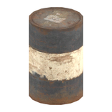
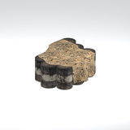
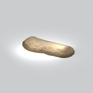
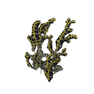
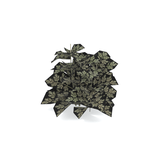
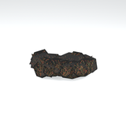
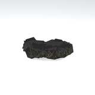
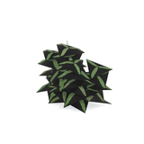

# Unclassified &gt; Unclassified components - page 5

[Library](../README.md) | [Source / advanced data](../catalogue.json) | [Credits](../sources-and-credits.md)

Static thumbnails only. Open a name or preview for its full still and 360-degree camera reference.

| Preview | Name | Game filename | Description | Tags | Variant / LOD |
|---|---|---|---|---|---|
|  | [Unidentified model (afgh_dcmt002)](../assets/mgsv-tpp-afgh_dcmt002-37a8a70e33807788.md) (unidentified) | afgh_dcmt002.fmdl | Native model reference; a readable object identification has not been reviewed. |  | Variant: No explicit variant token; LOD0; 178 triangles |
|  | [Unidentified model (afgh_dcmt002_vrtn001)](../assets/mgsv-tpp-afgh_dcmt002_vrtn001-d07ee5bbeea5fc19.md) (unidentified) | afgh_dcmt002_vrtn001.fmdl | Native model reference; a readable object identification has not been reviewed. |  | Variant: vrtn001; LOD0; 226 triangles |
|  | [Unidentified model (afgh_dish002)](../assets/mgsv-tpp-afgh_dish002-73041d0c8132018a.md) (unidentified) | afgh_dish002.fmdl | Native model reference; a readable object identification has not been reviewed. |  | Variant: No explicit variant token; LOD0; 72 triangles |
|  | [Unidentified model (afgh_drum004)](../assets/mgsv-tpp-afgh_drum004-2a872d67e63f6fdf.md) (unidentified) | afgh_drum004.fmdl | Native model reference; a readable object identification has not been reviewed. |  | Variant: No explicit variant token; LOD0; 60 triangles |
|  | [Unidentified model (afgh_drum005)](../assets/mgsv-tpp-afgh_drum005-c687a08244222de1.md) (unidentified) | afgh_drum005.fmdl | Native model reference; a readable object identification has not been reviewed. |  | Variant: No explicit variant token; LOD0; 541 triangles |
|  | [Unidentified model (afgh_dtch001)](../assets/mgsv-tpp-afgh_dtch001-582c59517aced982.md) (unidentified) | afgh_dtch001.fmdl | Native model reference; a readable object identification has not been reviewed. |  | Variant: No explicit variant token; LOD0; 334 triangles |
|  | [Unidentified model (afgh_flwr001)](../assets/mgsv-tpp-afgh_flwr001-87b4ef794f63b8de.md) (unidentified) | afgh_flwr001.fmdl | Native model reference; a readable object identification has not been reviewed. |  | Variant: No explicit variant token; LOD0; 402 triangles |
|  | [Unidentified model (afgh_flwr001_vrtn001)](../assets/mgsv-tpp-afgh_flwr001_vrtn001-173fa245e285c00f.md) (unidentified) | afgh_flwr001_vrtn001.fmdl | Native model reference; a readable object identification has not been reviewed. |  | Variant: vrtn001; LOD0; 555 triangles |
|  | [Unidentified model (afgh_flwr002)](../assets/mgsv-tpp-afgh_flwr002-68cfc45e13c2fd0e.md) (unidentified) | afgh_flwr002.fmdl | Native model reference; a readable object identification has not been reviewed. |  | Variant: No explicit variant token; LOD0; 150 triangles |
|  | [Unidentified model (afgh_flwr002_vrtn001)](../assets/mgsv-tpp-afgh_flwr002_vrtn001-6864b674168675ec.md) (unidentified) | afgh_flwr002_vrtn001.fmdl | Native model reference; a readable object identification has not been reviewed. |  | Variant: vrtn001; LOD0; 150 triangles |
|  | [Unidentified model (afgh_flwr003)](../assets/mgsv-tpp-afgh_flwr003-b1f49992bd2b0b1a.md) (unidentified) | afgh_flwr003.fmdl | Native model reference; a readable object identification has not been reviewed. |  | Variant: No explicit variant token; LOD0; 774 triangles |
|  | [Unidentified model (afgh_flwr003_vrtn001)](../assets/mgsv-tpp-afgh_flwr003_vrtn001-4a45ab3e97b11376.md) (unidentified) | afgh_flwr003_vrtn001.fmdl | Native model reference; a readable object identification has not been reviewed. |  | Variant: vrtn001; LOD0; 222 triangles |

Pages: [1](unclassified-components-1.md) | [2](unclassified-components-2.md) | [3](unclassified-components-3.md) | [4](unclassified-components-4.md) | [5](unclassified-components-5.md) | [6](unclassified-components-6.md) | [7](unclassified-components-7.md) | [8](unclassified-components-8.md) | [9](unclassified-components-9.md) | [10](unclassified-components-10.md) | [11](unclassified-components-11.md) | [12](unclassified-components-12.md) | [13](unclassified-components-13.md) | [14](unclassified-components-14.md) | [15](unclassified-components-15.md) | [16](unclassified-components-16.md) | [17](unclassified-components-17.md) | [18](unclassified-components-18.md) | [19](unclassified-components-19.md) | [20](unclassified-components-20.md) | [21](unclassified-components-21.md) | [22](unclassified-components-22.md) | [23](unclassified-components-23.md) | [24](unclassified-components-24.md) | [25](unclassified-components-25.md) | [26](unclassified-components-26.md) | [27](unclassified-components-27.md) | [28](unclassified-components-28.md) | [29](unclassified-components-29.md) | [30](unclassified-components-30.md) | [31](unclassified-components-31.md) | [32](unclassified-components-32.md)
