# Unclassified &gt; Unclassified components - page 6

[Library](../README.md) | [Source / advanced data](../catalogue.json) | [Credits](../sources-and-credits.md)

Static thumbnails only. Open a name or preview for its full still and 360-degree camera reference.

| Preview | Name | Game filename | Description | Tags | Variant / LOD |
|---|---|---|---|---|---|
| [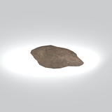](../assets/mgsv-tpp-mafr_mudd003-243592e747b06373.md) | [Unidentified model (mafr_mudd003)](../assets/mgsv-tpp-mafr_mudd003-243592e747b06373.md) (unidentified) | mafr_mudd003.fmdl | Native model reference; a readable object identification has not been reviewed. |  | Variant: No explicit variant token; LOD0; 184 triangles |
| [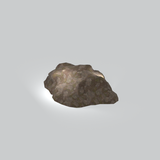](../assets/mgsv-tpp-mafr_mudd003_rock001-8547f3d3fca2c334.md) | [Unidentified model (mafr_mudd003_rock001)](../assets/mgsv-tpp-mafr_mudd003_rock001-8547f3d3fca2c334.md) (unidentified) | mafr_mudd003_rock001.fmdl | Native model reference; a readable object identification has not been reviewed. |  | Variant: No explicit variant token; LOD0; 629 triangles |
| [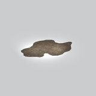](../assets/mgsv-tpp-mafr_mudd004_vrtn003-654dd8c95ab3548f.md) | [Unidentified model (mafr_mudd004_vrtn003)](../assets/mgsv-tpp-mafr_mudd004_vrtn003-654dd8c95ab3548f.md) (unidentified) | mafr_mudd004_vrtn003.fmdl | Native model reference; a readable object identification has not been reviewed. |  | Variant: vrtn003; LOD0; 155 triangles |
| [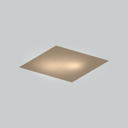](../assets/mgsv-tpp-mafr_pddl001_vrtn001-67f2f5aff0ffb21a.md) | [Unidentified model (mafr_pddl001_vrtn001)](../assets/mgsv-tpp-mafr_pddl001_vrtn001-67f2f5aff0ffb21a.md) (unidentified) | mafr_pddl001_vrtn001.fmdl | Native model reference; a readable object identification has not been reviewed. |  | Variant: vrtn001; LOD0; 2 triangles |
| [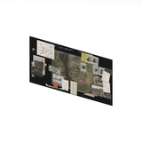](../assets/mgsv-tpp-mafr_pstr003-0e2f347f6f9a1fe3.md) | [Unidentified model (mafr_pstr003)](../assets/mgsv-tpp-mafr_pstr003-0e2f347f6f9a1fe3.md) (unidentified) | mafr_pstr003.fmdl | Native model reference; a readable object identification has not been reviewed. |  | Variant: No explicit variant token; LOD0; 2 triangles |
| [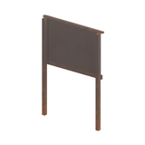](../assets/mgsv-tpp-mafr_sgbd001_vrtn001-025294d6ae80dc16.md) | [Unidentified model (mafr_sgbd001_vrtn001)](../assets/mgsv-tpp-mafr_sgbd001_vrtn001-025294d6ae80dc16.md) (unidentified) | mafr_sgbd001_vrtn001.fmdl | Native model reference; a readable object identification has not been reviewed. |  | Variant: vrtn001; LOD0; 60 triangles |
| [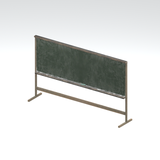](../assets/mgsv-tpp-mafr_sgbd002-17f31cefd9481eba.md) | [Unidentified model (mafr_sgbd002)](../assets/mgsv-tpp-mafr_sgbd002-17f31cefd9481eba.md) (unidentified) | mafr_sgbd002.fmdl | Native model reference; a readable object identification has not been reviewed. |  | Variant: No explicit variant token; LOD0; 134 triangles |
|  | [Unidentified model (mafr_star001)](../assets/mgsv-tpp-mafr_star001-0f0130f4088afe73.md) (unidentified) | mafr_star001.fmdl | Native model reference; a readable object identification has not been reviewed. |  | Variant: No explicit variant token; LOD0; 242 triangles |
| [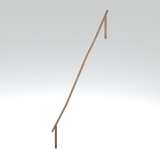](../assets/mgsv-tpp-mafr_star001_vrtn001-5df3cce8af37d094.md) | [Unidentified model (mafr_star001_vrtn001)](../assets/mgsv-tpp-mafr_star001_vrtn001-5df3cce8af37d094.md) (unidentified) | mafr_star001_vrtn001.fmdl | Native model reference; a readable object identification has not been reviewed. |  | Variant: vrtn001; LOD0; 62 triangles |
| [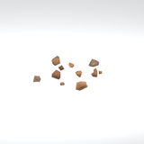](../assets/mgsv-tpp-mafr_ston002_rock001-5f3c143161fb6168.md) | [Unidentified model (mafr_ston002_rock001)](../assets/mgsv-tpp-mafr_ston002_rock001-5f3c143161fb6168.md) (unidentified) | mafr_ston002_rock001.fmdl | Native model reference; a readable object identification has not been reviewed. |  | Variant: No explicit variant token; LOD0; 218 triangles |
| [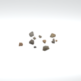](../assets/mgsv-tpp-mafr_ston002_rock002-a8b236d00b1e54d5.md) | [Unidentified model (mafr_ston002_rock002)](../assets/mgsv-tpp-mafr_ston002_rock002-a8b236d00b1e54d5.md) (unidentified) | mafr_ston002_rock002.fmdl | Native model reference; a readable object identification has not been reviewed. |  | Variant: No explicit variant token; LOD0; 218 triangles |
| [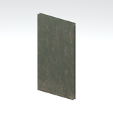](../assets/mgsv-tpp-mafr_tent002_door001_gm-e95f75d3b7e14ffe.md) | [Unidentified model (mafr_tent002_door001_gm)](../assets/mgsv-tpp-mafr_tent002_door001_gm-e95f75d3b7e14ffe.md) (unidentified) | mafr_tent002_door001_gm.fmdl | Native model reference; a readable object identification has not been reviewed. |  | Variant: No explicit variant token; LOD0; 4 triangles |

Pages: [1](unclassified-components-1.md) | [2](unclassified-components-2.md) | [3](unclassified-components-3.md) | [4](unclassified-components-4.md) | [5](unclassified-components-5.md) | [6](unclassified-components-6.md) | [7](unclassified-components-7.md) | [8](unclassified-components-8.md) | [9](unclassified-components-9.md)
