# Unclassified &gt; Unclassified components - page 6

[Library](../README.md) | [Source / advanced data](../catalogue.json) | [Credits](../sources-and-credits.md)

Static thumbnails only. Open a name or preview for its full still and 360-degree camera reference.

| Preview | Name | Game filename | Description | Tags | Variant / LOD |
|---|---|---|---|---|---|
| [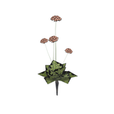](../assets/mgsv-tpp-afgh_flwr004-b45d5cc7278a7876.md) | [Unidentified model (afgh_flwr004)](../assets/mgsv-tpp-afgh_flwr004-b45d5cc7278a7876.md) (unidentified) | afgh_flwr004.fmdl | Native model reference; a readable object identification has not been reviewed. |  | Variant: No explicit variant token; LOD0; 672 triangles |
| [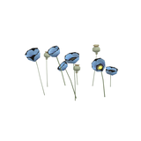](../assets/mgsv-tpp-afgh_flwr005-c47fbd2baa6b3804.md) | [Unidentified model (afgh_flwr005)](../assets/mgsv-tpp-afgh_flwr005-c47fbd2baa6b3804.md) (unidentified) | afgh_flwr005.fmdl | Native model reference; a readable object identification has not been reviewed. |  | Variant: No explicit variant token; LOD0; 534 triangles |
| [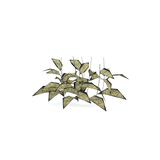](../assets/mgsv-tpp-afgh_flwr005_vrtn001-0ef480094451adae.md) | [Unidentified model (afgh_flwr005_vrtn001)](../assets/mgsv-tpp-afgh_flwr005_vrtn001-0ef480094451adae.md) (unidentified) | afgh_flwr005_vrtn001.fmdl | Native model reference; a readable object identification has not been reviewed. |  | Variant: vrtn001; LOD0; 434 triangles |
| [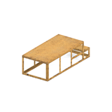](../assets/mgsv-tpp-afgh_fndt003-bffa9241f072249d.md) | [Unidentified model (afgh_fndt003)](../assets/mgsv-tpp-afgh_fndt003-bffa9241f072249d.md) (unidentified) | afgh_fndt003.fmdl | Native model reference; a readable object identification has not been reviewed. |  | Variant: No explicit variant token; LOD0; 192 triangles |
| [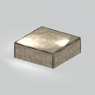](../assets/mgsv-tpp-afgh_fndt007-ea1a70789d8c4f34.md) | [Unidentified model (afgh_fndt007)](../assets/mgsv-tpp-afgh_fndt007-ea1a70789d8c4f34.md) (unidentified) | afgh_fndt007.fmdl | Native model reference; a readable object identification has not been reviewed. |  | Variant: No explicit variant token; LOD0; 42 triangles |
| [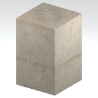](../assets/mgsv-tpp-afgh_fndt008_vrtn001-e516230f2e6abc86.md) | [Unidentified model (afgh_fndt008_vrtn001)](../assets/mgsv-tpp-afgh_fndt008_vrtn001-e516230f2e6abc86.md) (unidentified) | afgh_fndt008_vrtn001.fmdl | Native model reference; a readable object identification has not been reviewed. |  | Variant: vrtn001; LOD0; 10 triangles |
| [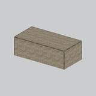](../assets/mgsv-tpp-afgh_fndt012_vrtn001-579f22530ea77bb3.md) | [Unidentified model (afgh_fndt012_vrtn001)](../assets/mgsv-tpp-afgh_fndt012_vrtn001-579f22530ea77bb3.md) (unidentified) | afgh_fndt012_vrtn001.fmdl | Native model reference; a readable object identification has not been reviewed. |  | Variant: vrtn001; LOD0; 42 triangles |
| [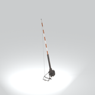](../assets/mgsv-tpp-afgh_gate002-240842da7f575bb2.md) | [Unidentified model (afgh_gate002)](../assets/mgsv-tpp-afgh_gate002-240842da7f575bb2.md) (unidentified) | afgh_gate002.fmdl | Native model reference; a readable object identification has not been reviewed. |  | Variant: No explicit variant token; LOD0; 276 triangles |
| [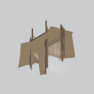](../assets/mgsv-tpp-afgh_gate003-2c171611ee7abf22.md) | [Unidentified model (afgh_gate003)](../assets/mgsv-tpp-afgh_gate003-2c171611ee7abf22.md) (unidentified) | afgh_gate003.fmdl | Native model reference; a readable object identification has not been reviewed. |  | Variant: No explicit variant token; LOD0; 564 triangles |
| [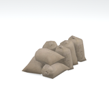](../assets/mgsv-tpp-afgh_gnsc001_gnsc001-7fa16d3ccd380d4f.md) | [Unidentified model (afgh_gnsc001_gnsc001)](../assets/mgsv-tpp-afgh_gnsc001_gnsc001-7fa16d3ccd380d4f.md) (unidentified) | afgh_gnsc001_gnsc001.fmdl | Native model reference; a readable object identification has not been reviewed. |  | Variant: No explicit variant token; LOD0; 716 triangles |
| [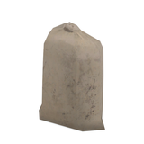](../assets/mgsv-tpp-afgh_gnsc001_gnsc002-b7e3a93cff6cb5db.md) | [Unidentified model (afgh_gnsc001_gnsc002)](../assets/mgsv-tpp-afgh_gnsc001_gnsc002-b7e3a93cff6cb5db.md) (unidentified) | afgh_gnsc001_gnsc002.fmdl | Native model reference; a readable object identification has not been reviewed. |  | Variant: No explicit variant token; LOD0; 116 triangles |
| [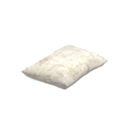](../assets/mgsv-tpp-afgh_gnsc003_gnsc001-c83d6f2514952e7f.md) | [Unidentified model (afgh_gnsc003_gnsc001)](../assets/mgsv-tpp-afgh_gnsc003_gnsc001-c83d6f2514952e7f.md) (unidentified) | afgh_gnsc003_gnsc001.fmdl | Native model reference; a readable object identification has not been reviewed. |  | Variant: No explicit variant token; LOD0; 106 triangles |

Pages: [1](unclassified-components-1.md) | [2](unclassified-components-2.md) | [3](unclassified-components-3.md) | [4](unclassified-components-4.md) | [5](unclassified-components-5.md) | [6](unclassified-components-6.md) | [7](unclassified-components-7.md) | [8](unclassified-components-8.md) | [9](unclassified-components-9.md) | [10](unclassified-components-10.md) | [11](unclassified-components-11.md) | [12](unclassified-components-12.md) | [13](unclassified-components-13.md) | [14](unclassified-components-14.md) | [15](unclassified-components-15.md) | [16](unclassified-components-16.md) | [17](unclassified-components-17.md) | [18](unclassified-components-18.md) | [19](unclassified-components-19.md) | [20](unclassified-components-20.md) | [21](unclassified-components-21.md) | [22](unclassified-components-22.md) | [23](unclassified-components-23.md) | [24](unclassified-components-24.md) | [25](unclassified-components-25.md) | [26](unclassified-components-26.md) | [27](unclassified-components-27.md) | [28](unclassified-components-28.md) | [29](unclassified-components-29.md) | [30](unclassified-components-30.md) | [31](unclassified-components-31.md) | [32](unclassified-components-32.md) | [33](unclassified-components-33.md)
