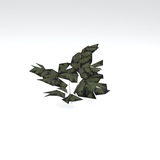
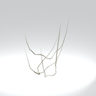
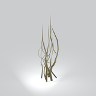
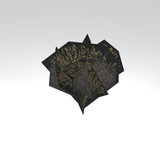

# Unclassified &gt; Unclassified components - page 7

[Library](../README.md) | [Source / advanced data](../catalogue.json) | [Credits](../sources-and-credits.md)

Static thumbnails only. Open a name or preview for its full still and 360-degree camera reference.

| Preview | Name | Game filename | Description | Tags | Variant / LOD |
|---|---|---|---|---|---|
|  | [Unidentified model (mafr_tire001)](../assets/mgsv-tpp-mafr_tire001-bfcd33127983d23b.md) (unidentified) | mafr_tire001.fmdl | Native model reference; a readable object identification has not been reviewed. |  | Variant: No explicit variant token; LOD0; 120 triangles |
|  | [Unidentified model (mafr_tnwl003_vrtn001)](../assets/mgsv-tpp-mafr_tnwl003_vrtn001-1a71a8ff705f3bd2.md) (unidentified) | mafr_tnwl003_vrtn001.fmdl | Native model reference; a readable object identification has not been reviewed. |  | Variant: vrtn001; LOD0; 16 triangles |
|  | [Unidentified model (mafr_tree005_dsvw004)](../assets/mgsv-tpp-mafr_tree005_dsvw004-be223beb64535229.md) (unidentified) | mafr_tree005_dsvw004.fmdl | Native model reference; a readable object identification has not been reviewed. |  | Variant: No explicit variant token; LOD0; 22 triangles |
|  | [Unidentified model (mafr_tree005_vrtn005)](../assets/mgsv-tpp-mafr_tree005_vrtn005-4f329b4bb99f891d.md) (unidentified) | mafr_tree005_vrtn005.fmdl | Native model reference; a readable object identification has not been reviewed. |  | Variant: vrtn005; LOD0; 669 triangles |
|  | [Unidentified model (mafr_tree009_acca002_gen8)](../assets/mgsv-tpp-mafr_tree009_acca002_gen8-9c23f56d592bfe70.md) (unidentified) | mafr_tree009_acca002_gen8.fmdl | Native model reference; a readable object identification has not been reviewed. |  | Variant: No explicit variant token; LOD0; 167 triangles |
|  | [Unidentified model (mafr_tree016_vrtn002)](../assets/mgsv-tpp-mafr_tree016_vrtn002-5226ac71e0ced8ea.md) (unidentified) | mafr_tree016_vrtn002.fmdl | Native model reference; a readable object identification has not been reviewed. |  | Variant: vrtn002; LOD0; 372 triangles |
|  | [Unidentified model (mafr_tree016_vrtn004)](../assets/mgsv-tpp-mafr_tree016_vrtn004-4f3efbc515c9f15e.md) (unidentified) | mafr_tree016_vrtn004.fmdl | Native model reference; a readable object identification has not been reviewed. |  | Variant: vrtn004; LOD0; 668 triangles |
|  | [Unidentified model (mafr_tree018)](../assets/mgsv-tpp-mafr_tree018-bacf0317d5b3d3f2.md) (unidentified) | mafr_tree018.fmdl | Native model reference; a readable object identification has not been reviewed. |  | Variant: No explicit variant token; LOD0; 94 triangles |
|  | [Unidentified model (mgom_hutt003_vrtn001)](../assets/mgsv-tpp-mgom_hutt003_vrtn001-2a1ffc6882b7ee80.md) (unidentified) | mgom_hutt003_vrtn001.fmdl | Native model reference; a readable object identification has not been reviewed. |  | Variant: vrtn001; LOD0; 194 triangles |
|  | [Unidentified model (mgom_pstr003_vrtn006)](../assets/mgsv-tpp-mgom_pstr003_vrtn006-2a6645d2bd73c641.md) (unidentified) | mgom_pstr003_vrtn006.fmdl | Native model reference; a readable object identification has not been reviewed. |  | Variant: vrtn006; LOD0; 20 triangles |
|  | [Unidentified model (mgom_tnwl003)](../assets/mgsv-tpp-mgom_tnwl003-01a9f19ba23b860f.md) (unidentified) | mgom_tnwl003.fmdl | Native model reference; a readable object identification has not been reviewed. |  | Variant: No explicit variant token; LOD0; 240 triangles |
|  | [Unidentified model (mgom_wdbx001_vrtn001)](../assets/mgsv-tpp-mgom_wdbx001_vrtn001-a7081a751f6e35cc.md) (unidentified) | mgom_wdbx001_vrtn001.fmdl | Native model reference; a readable object identification has not been reviewed. |  | Variant: vrtn001; LOD0; 772 triangles |

Pages: [1](unclassified-components-1.md) | [2](unclassified-components-2.md) | [3](unclassified-components-3.md) | [4](unclassified-components-4.md) | [5](unclassified-components-5.md) | [6](unclassified-components-6.md) | [7](unclassified-components-7.md) | [8](unclassified-components-8.md)
