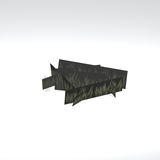
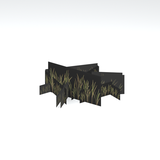
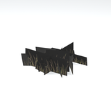
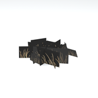
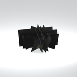
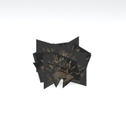
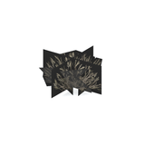
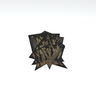
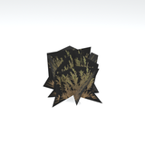

# Unclassified &gt; Unclassified components - page 7

[Library](../README.md) | [Source / advanced data](../catalogue.json) | [Credits](../sources-and-credits.md)

Static thumbnails only. Open a name or preview for its full still and 360-degree camera reference.

| Preview | Name | Game filename | Description | Tags | Variant / LOD |
|---|---|---|---|---|---|
|  | [Unidentified model (afgh_grss022_vrtn001)](../assets/mgsv-tpp-afgh_grss022_vrtn001-7ae8c287151b1513.md) (unidentified) | afgh_grss022_vrtn001.fmdl | Native model reference; a readable object identification has not been reviewed. |  | Variant: vrtn001; LOD0; 26 triangles |
|  | [Unidentified model (afgh_grss022_vrtn002)](../assets/mgsv-tpp-afgh_grss022_vrtn002-0ef2f946c353fa65.md) (unidentified) | afgh_grss022_vrtn002.fmdl | Native model reference; a readable object identification has not been reviewed. |  | Variant: vrtn002; LOD0; 26 triangles |
|  | [Unidentified model (afgh_grss022_vrtn003)](../assets/mgsv-tpp-afgh_grss022_vrtn003-8b3e95e3af9563db.md) (unidentified) | afgh_grss022_vrtn003.fmdl | Native model reference; a readable object identification has not been reviewed. |  | Variant: vrtn003; LOD0; 34 triangles |
|  | [Unidentified model (afgh_grss022_vrtn008)](../assets/mgsv-tpp-afgh_grss022_vrtn008-6fbd7cea3f9b4a75.md) (unidentified) | afgh_grss022_vrtn008.fmdl | Native model reference; a readable object identification has not been reviewed. |  | Variant: vrtn008; LOD0; 34 triangles |
|  | [Unidentified model (afgh_grss024)](../assets/mgsv-tpp-afgh_grss024-df529028b79925e6.md) (unidentified) | afgh_grss024.fmdl | Native model reference; a readable object identification has not been reviewed. |  | Variant: No explicit variant token; LOD0; 24 triangles |
|  | [Unidentified model (afgh_grss024_vrtn001)](../assets/mgsv-tpp-afgh_grss024_vrtn001-152d654b3c04bf1b.md) (unidentified) | afgh_grss024_vrtn001.fmdl | Native model reference; a readable object identification has not been reviewed. |  | Variant: vrtn001; LOD0; 25 triangles |
|  | [Unidentified model (afgh_grss024_vrtn002)](../assets/mgsv-tpp-afgh_grss024_vrtn002-cbb6b8a0aaab8bc3.md) (unidentified) | afgh_grss024_vrtn002.fmdl | Native model reference; a readable object identification has not been reviewed. |  | Variant: vrtn002; LOD0; 26 triangles |
|  | [Unidentified model (afgh_grss025_vrtn001)](../assets/mgsv-tpp-afgh_grss025_vrtn001-c50f8b1ba691c2f4.md) (unidentified) | afgh_grss025_vrtn001.fmdl | Native model reference; a readable object identification has not been reviewed. |  | Variant: vrtn001; LOD0; 40 triangles |
|  | [Unidentified model (afgh_grss025_vrtn002)](../assets/mgsv-tpp-afgh_grss025_vrtn002-932e2d4570b1c77e.md) (unidentified) | afgh_grss025_vrtn002.fmdl | Native model reference; a readable object identification has not been reviewed. |  | Variant: vrtn002; LOD0; 40 triangles |
|  | [Unidentified model (afgh_grss025_vrtn003)](../assets/mgsv-tpp-afgh_grss025_vrtn003-80d67102939c5508.md) (unidentified) | afgh_grss025_vrtn003.fmdl | Native model reference; a readable object identification has not been reviewed. |  | Variant: vrtn003; LOD0; 14 triangles |
|  | [Unidentified model (afgh_gscy001_gm)](../assets/mgsv-tpp-afgh_gscy001_gm-f0f8623eb7f77d15.md) (unidentified) | afgh_gscy001_gm.fmdl | Native model reference; a readable object identification has not been reviewed. |  | Variant: No explicit variant token; LOD0; 312 triangles |
|  | [Unidentified model (afgh_pstr001_vrtn002)](../assets/mgsv-tpp-afgh_pstr001_vrtn002-884df9f5ecdee5c4.md) (unidentified) | afgh_pstr001_vrtn002.fmdl | Native model reference; a readable object identification has not been reviewed. |  | Variant: vrtn002; LOD0; 6 triangles |

Pages: [1](unclassified-components-1.md) | [2](unclassified-components-2.md) | [3](unclassified-components-3.md) | [4](unclassified-components-4.md) | [5](unclassified-components-5.md) | [6](unclassified-components-6.md) | [7](unclassified-components-7.md) | [8](unclassified-components-8.md) | [9](unclassified-components-9.md) | [10](unclassified-components-10.md) | [11](unclassified-components-11.md) | [12](unclassified-components-12.md) | [13](unclassified-components-13.md) | [14](unclassified-components-14.md) | [15](unclassified-components-15.md) | [16](unclassified-components-16.md) | [17](unclassified-components-17.md) | [18](unclassified-components-18.md) | [19](unclassified-components-19.md) | [20](unclassified-components-20.md) | [21](unclassified-components-21.md) | [22](unclassified-components-22.md) | [23](unclassified-components-23.md) | [24](unclassified-components-24.md) | [25](unclassified-components-25.md) | [26](unclassified-components-26.md) | [27](unclassified-components-27.md) | [28](unclassified-components-28.md) | [29](unclassified-components-29.md) | [30](unclassified-components-30.md) | [31](unclassified-components-31.md)
