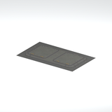
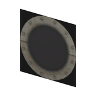
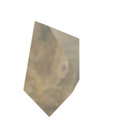

# Unclassified &gt; Unclassified components - page 8

[Library](../README.md) | [Source / advanced data](../catalogue.json) | [Credits](../sources-and-credits.md)

Static thumbnails only. Open a name or preview for its full still and 360-degree camera reference.

| Preview | Name | Game filename | Description | Tags | Variant / LOD |
|---|---|---|---|---|---|
|  | [Unidentified model (afgh_pstr002_vrtn006)](../assets/mgsv-tpp-afgh_pstr002_vrtn006-dad41af632877891.md) (unidentified) | afgh_pstr002_vrtn006.fmdl | Native model reference; a readable object identification has not been reviewed. |  | Variant: vrtn006; LOD0; 14 triangles |
|  | [Unidentified model (afgh_sndb003_vrtn001)](../assets/mgsv-tpp-afgh_sndb003_vrtn001-7b0c71e3412a9a4a.md) (unidentified) | afgh_sndb003_vrtn001.fmdl | Native model reference; a readable object identification has not been reviewed. |  | Variant: vrtn001; LOD0; 509 triangles |
|  | [Unidentified model (afgh_sndb004_vrtn001)](../assets/mgsv-tpp-afgh_sndb004_vrtn001-bdc22555283c2141.md) (unidentified) | afgh_sndb004_vrtn001.fmdl | Native model reference; a readable object identification has not been reviewed. |  | Variant: vrtn001; LOD0; 871 triangles |
|  | [Unidentified model (afgh_trck002_trck001)](../assets/mgsv-tpp-afgh_trck002_trck001-ad7330f2b92a7d77.md) (unidentified) | afgh_trck002_trck001.fmdl | Native model reference; a readable object identification has not been reviewed. |  | Variant: No explicit variant token; LOD0; 1548 triangles |
|  | [Unidentified model (cm_mtbs_dc_sign002_vrtn001)](../assets/mgsv-tpp-cm_mtbs_dc_sign002_vrtn001-ead5c71f481c2c51.md) (unidentified) | cm_mtbs_dc_sign002_vrtn001.fmdl | Native model reference; a readable object identification has not been reviewed. |  | Variant: vrtn001; LOD0; 2 triangles |
|  | [Unidentified model (cm_mtbs_htch002)](../assets/mgsv-tpp-cm_mtbs_htch002-84bc1e26bdffa583.md) (unidentified) | cm_mtbs_htch002.fmdl | Native model reference; a readable object identification has not been reviewed. |  | Variant: No explicit variant token; LOD0; 56 triangles |
|  | [Unidentified model (cm_mtbs_wall008_pipe001)](../assets/mgsv-tpp-cm_mtbs_wall008_pipe001-7e542dc13bdbf4b9.md) (unidentified) | cm_mtbs_wall008_pipe001.fmdl | Native model reference; a readable object identification has not been reviewed. |  | Variant: No explicit variant token; LOD0; 2 triangles |
|  | [Unidentified model (fxm_fragment02)](../assets/mgsv-tpp-fxm_fragment02-82289c702f858ba5.md) (unidentified) | fxm_fragment02.fmdl | Native model reference; a readable object identification has not been reviewed. |  | Variant: No explicit variant token; LOD0; 14 triangles |
|  | [Unidentified model (gntn_pllt002_vrtn001)](../assets/mgsv-tpp-gntn_pllt002_vrtn001-4009be9852b8f0dd.md) (unidentified) | gntn_pllt002_vrtn001.fmdl | Native model reference; a readable object identification has not been reviewed. |  | Variant: vrtn001; LOD0; 406 triangles |
|  | [Unidentified model (gntn_tmbr001_tmbr002)](../assets/mgsv-tpp-gntn_tmbr001_tmbr002-dba5931e90b0c03e.md) (unidentified) | gntn_tmbr001_tmbr002.fmdl | Native model reference; a readable object identification has not been reviewed. |  | Variant: No explicit variant token; LOD0; 96 triangles |
|  | [Unidentified model (gntn_wdbx002_vrtn005)](../assets/mgsv-tpp-gntn_wdbx002_vrtn005-e788a59ead7d3c33.md) (unidentified) | gntn_wdbx002_vrtn005.fmdl | Native model reference; a readable object identification has not been reviewed. |  | Variant: vrtn005; LOD0; 77 triangles |
|  | [Unidentified model (mafr_bckt001)](../assets/mgsv-tpp-mafr_bckt001-1b44a950d78b7e59.md) (unidentified) | mafr_bckt001.fmdl | Native model reference; a readable object identification has not been reviewed. |  | Variant: No explicit variant token; LOD0; 172 triangles |

Pages: [1](unclassified-components-1.md) | [2](unclassified-components-2.md) | [3](unclassified-components-3.md) | [4](unclassified-components-4.md) | [5](unclassified-components-5.md) | [6](unclassified-components-6.md) | [7](unclassified-components-7.md) | [8](unclassified-components-8.md) | [9](unclassified-components-9.md) | [10](unclassified-components-10.md) | [11](unclassified-components-11.md) | [12](unclassified-components-12.md) | [13](unclassified-components-13.md) | [14](unclassified-components-14.md) | [15](unclassified-components-15.md) | [16](unclassified-components-16.md) | [17](unclassified-components-17.md) | [18](unclassified-components-18.md) | [19](unclassified-components-19.md) | [20](unclassified-components-20.md) | [21](unclassified-components-21.md) | [22](unclassified-components-22.md) | [23](unclassified-components-23.md) | [24](unclassified-components-24.md) | [25](unclassified-components-25.md) | [26](unclassified-components-26.md) | [27](unclassified-components-27.md) | [28](unclassified-components-28.md) | [29](unclassified-components-29.md) | [30](unclassified-components-30.md) | [31](unclassified-components-31.md)
