# Unclassified &gt; Unclassified components - page 8

[Library](../README.md) | [Source / advanced data](../catalogue.json) | [Credits](../sources-and-credits.md)

Static thumbnails only. Open a name or preview for its full still and 360-degree camera reference.

| Preview | Name | Game filename | Description | Tags | Variant / LOD |
|---|---|---|---|---|---|
| [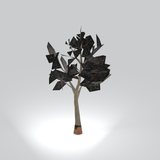](../assets/mgsv-tpp-mafr_tree021-438e9d5288f152d3.md) | [Unidentified model (mafr_tree021)](../assets/mgsv-tpp-mafr_tree021-438e9d5288f152d3.md) (unidentified) | mafr_tree021.fmdl | Native model reference; a readable object identification has not been reviewed. |  | Variant: No explicit variant token; LOD0; 714 triangles |
| [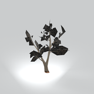](../assets/mgsv-tpp-mafr_tree021_vrtn001-e87942707b1bace1.md) | [Unidentified model (mafr_tree021_vrtn001)](../assets/mgsv-tpp-mafr_tree021_vrtn001-e87942707b1bace1.md) (unidentified) | mafr_tree021_vrtn001.fmdl | Native model reference; a readable object identification has not been reviewed. |  | Variant: vrtn001; LOD0; 560 triangles |
| [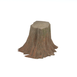](../assets/mgsv-tpp-mafr_tree021_vrtn002-cf65ac204a8f6fb8.md) | [Unidentified model (mafr_tree021_vrtn002)](../assets/mgsv-tpp-mafr_tree021_vrtn002-cf65ac204a8f6fb8.md) (unidentified) | mafr_tree021_vrtn002.fmdl | Native model reference; a readable object identification has not been reviewed. |  | Variant: vrtn002; LOD0; 283 triangles |
| [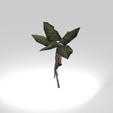](../assets/mgsv-tpp-mafr_tree023-d6b4fd5d542ab159.md) | [Unidentified model (mafr_tree023)](../assets/mgsv-tpp-mafr_tree023-d6b4fd5d542ab159.md) (unidentified) | mafr_tree023.fmdl | Native model reference; a readable object identification has not been reviewed. |  | Variant: No explicit variant token; LOD0; 529 triangles |
| [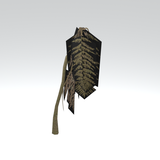](../assets/mgsv-tpp-mafr_tree023_vrtn004-502d816b0587d654.md) | [Unidentified model (mafr_tree023_vrtn004)](../assets/mgsv-tpp-mafr_tree023_vrtn004-502d816b0587d654.md) (unidentified) | mafr_tree023_vrtn004.fmdl | Native model reference; a readable object identification has not been reviewed. |  | Variant: vrtn004; LOD0; 367 triangles |
| [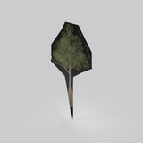](../assets/mgsv-tpp-mafr_tree028_dsvw002-cb03d1cb13a9380d.md) | [Unidentified model (mafr_tree028_dsvw002)](../assets/mgsv-tpp-mafr_tree028_dsvw002-cb03d1cb13a9380d.md) (unidentified) | mafr_tree028_dsvw002.fmdl | Native model reference; a readable object identification has not been reviewed. |  | Variant: No explicit variant token; LOD0; 14 triangles |
| [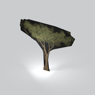](../assets/mgsv-tpp-mafr_tree030_dsvw002-7787e818a241c160.md) | [Unidentified model (mafr_tree030_dsvw002)](../assets/mgsv-tpp-mafr_tree030_dsvw002-7787e818a241c160.md) (unidentified) | mafr_tree030_dsvw002.fmdl | Native model reference; a readable object identification has not been reviewed. |  | Variant: No explicit variant token; LOD0; 30 triangles |
| [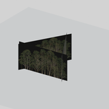](../assets/mgsv-tpp-mafr_tree031_vrtn001-324e7ac754354182.md) | [Unidentified model (mafr_tree031_vrtn001)](../assets/mgsv-tpp-mafr_tree031_vrtn001-324e7ac754354182.md) (unidentified) | mafr_tree031_vrtn001.fmdl | Native model reference; a readable object identification has not been reviewed. |  | Variant: vrtn001; LOD0; 6 triangles |
| [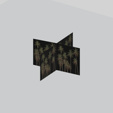](../assets/mgsv-tpp-mafr_tree031_vrtn003-522c89c96ecef584.md) | [Unidentified model (mafr_tree031_vrtn003)](../assets/mgsv-tpp-mafr_tree031_vrtn003-522c89c96ecef584.md) (unidentified) | mafr_tree031_vrtn003.fmdl | Native model reference; a readable object identification has not been reviewed. |  | Variant: vrtn003; LOD0; 8 triangles |
|  | [Unidentified model (mafr_tree031_vrtn005)](../assets/mgsv-tpp-mafr_tree031_vrtn005-eaa9a48b67cecf41.md) (unidentified) | mafr_tree031_vrtn005.fmdl | Native model reference; a readable object identification has not been reviewed. |  | Variant: vrtn005; LOD0; 2 triangles |
| [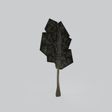](../assets/mgsv-tpp-mafr_tree034_dsvw002-18488aacee22be0f.md) | [Unidentified model (mafr_tree034_dsvw002)](../assets/mgsv-tpp-mafr_tree034_dsvw002-18488aacee22be0f.md) (unidentified) | mafr_tree034_dsvw002.fmdl | Native model reference; a readable object identification has not been reviewed. |  | Variant: No explicit variant token; LOD0; 85 triangles |
| [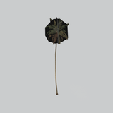](../assets/mgsv-tpp-mafr_tree038-c63d07ba8abcff33.md) | [Unidentified model (mafr_tree038)](../assets/mgsv-tpp-mafr_tree038-c63d07ba8abcff33.md) (unidentified) | mafr_tree038.fmdl | Native model reference; a readable object identification has not been reviewed. |  | Variant: No explicit variant token; LOD0; 850 triangles |

Pages: [1](unclassified-components-1.md) | [2](unclassified-components-2.md) | [3](unclassified-components-3.md) | [4](unclassified-components-4.md) | [5](unclassified-components-5.md) | [6](unclassified-components-6.md) | [7](unclassified-components-7.md) | [8](unclassified-components-8.md) | [9](unclassified-components-9.md) | [10](unclassified-components-10.md) | [11](unclassified-components-11.md) | [12](unclassified-components-12.md) | [13](unclassified-components-13.md) | [14](unclassified-components-14.md) | [15](unclassified-components-15.md) | [16](unclassified-components-16.md) | [17](unclassified-components-17.md) | [18](unclassified-components-18.md) | [19](unclassified-components-19.md) | [20](unclassified-components-20.md) | [21](unclassified-components-21.md) | [22](unclassified-components-22.md) | [23](unclassified-components-23.md)
