# Unclassified &gt; Unclassified components - page 8

[Library](../README.md) | [Source / advanced data](../catalogue.json) | [Credits](../sources-and-credits.md)

Static thumbnails only. Open a name or preview for its full still and 360-degree camera reference.

| Preview | Name | Game filename | Description | Tags | Variant / LOD |
|---|---|---|---|---|---|
| [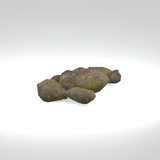](../assets/mgsv-tpp-mafr_grnd004-9afc44bd29201075.md) | [Unidentified model (mafr_grnd004)](../assets/mgsv-tpp-mafr_grnd004-9afc44bd29201075.md) (unidentified) | mafr_grnd004.fmdl | Native model reference; a readable object identification has not been reviewed. |  | Variant: No explicit variant token; LOD0; 680 triangles |
| [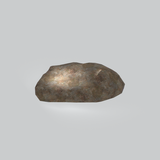](../assets/mgsv-tpp-mafr_grnd004_vrtn001-48ca0901768b0700.md) | [Unidentified model (mafr_grnd004_vrtn001)](../assets/mgsv-tpp-mafr_grnd004_vrtn001-48ca0901768b0700.md) (unidentified) | mafr_grnd004_vrtn001.fmdl | Native model reference; a readable object identification has not been reviewed. |  | Variant: vrtn001; LOD0; 441 triangles |
| [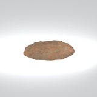](../assets/mgsv-tpp-mafr_grnd005-db5e1dadddba21af.md) | [Unidentified model (mafr_grnd005)](../assets/mgsv-tpp-mafr_grnd005-db5e1dadddba21af.md) (unidentified) | mafr_grnd005.fmdl | Native model reference; a readable object identification has not been reviewed. |  | Variant: No explicit variant token; LOD0; 220 triangles |
| [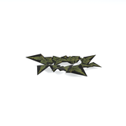](../assets/mgsv-tpp-mafr_grss009_vrtn002-0e964844a2584f69.md) | [Unidentified model (mafr_grss009_vrtn002)](../assets/mgsv-tpp-mafr_grss009_vrtn002-0e964844a2584f69.md) (unidentified) | mafr_grss009_vrtn002.fmdl | Native model reference; a readable object identification has not been reviewed. |  | Variant: vrtn002; LOD0; 64 triangles |
| [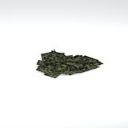](../assets/mgsv-tpp-mafr_grss019-69c6c19bc109e294.md) | [Unidentified model (mafr_grss019)](../assets/mgsv-tpp-mafr_grss019-69c6c19bc109e294.md) (unidentified) | mafr_grss019.fmdl | Native model reference; a readable object identification has not been reviewed. |  | Variant: No explicit variant token; LOD0; 74 triangles |
| [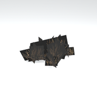](../assets/mgsv-tpp-mafr_grss022-1ed9a46ccdd8c8a6.md) | [Unidentified model (mafr_grss022)](../assets/mgsv-tpp-mafr_grss022-1ed9a46ccdd8c8a6.md) (unidentified) | mafr_grss022.fmdl | Native model reference; a readable object identification has not been reviewed. |  | Variant: No explicit variant token; LOD0; 57 triangles |
| [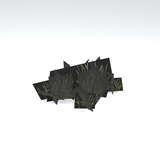](../assets/mgsv-tpp-mafr_grss022_vrtn001-32d8e40a833528cf.md) | [Unidentified model (mafr_grss022_vrtn001)](../assets/mgsv-tpp-mafr_grss022_vrtn001-32d8e40a833528cf.md) (unidentified) | mafr_grss022_vrtn001.fmdl | Native model reference; a readable object identification has not been reviewed. |  | Variant: vrtn001; LOD0; 57 triangles |
| [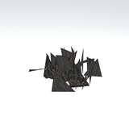](../assets/mgsv-tpp-mafr_grss022_vrtn005-92b4f58bb243f226.md) | [Unidentified model (mafr_grss022_vrtn005)](../assets/mgsv-tpp-mafr_grss022_vrtn005-92b4f58bb243f226.md) (unidentified) | mafr_grss022_vrtn005.fmdl | Native model reference; a readable object identification has not been reviewed. |  | Variant: vrtn005; LOD0; 74 triangles |
| [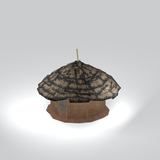](../assets/mgsv-tpp-mafr_hous002-6b3b42484641e792.md) | [Unidentified model (mafr_hous002)](../assets/mgsv-tpp-mafr_hous002-6b3b42484641e792.md) (unidentified) | mafr_hous002.fmdl | Native model reference; a readable object identification has not been reviewed. |  | Variant: No explicit variant token; LOD0; 921 triangles |
| [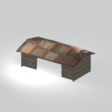](../assets/mgsv-tpp-mafr_hous017-fbc80a0c6f19960a.md) | [Unidentified model (mafr_hous017)](../assets/mgsv-tpp-mafr_hous017-fbc80a0c6f19960a.md) (unidentified) | mafr_hous017.fmdl | Native model reference; a readable object identification has not been reviewed. |  | Variant: No explicit variant token; LOD0; 1190 triangles |
| [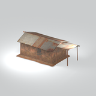](../assets/mgsv-tpp-mafr_hous019-670db7da68f361d0.md) | [Unidentified model (mafr_hous019)](../assets/mgsv-tpp-mafr_hous019-670db7da68f361d0.md) (unidentified) | mafr_hous019.fmdl | Native model reference; a readable object identification has not been reviewed. |  | Variant: No explicit variant token; LOD0; 648 triangles |
| [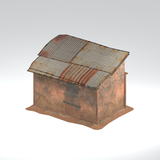](../assets/mgsv-tpp-mafr_hous019_vrtn001-6f094583de6aa005.md) | [Unidentified model (mafr_hous019_vrtn001)](../assets/mgsv-tpp-mafr_hous019_vrtn001-6f094583de6aa005.md) (unidentified) | mafr_hous019_vrtn001.fmdl | Native model reference; a readable object identification has not been reviewed. |  | Variant: vrtn001; LOD0; 398 triangles |

Pages: [1](unclassified-components-1.md) | [2](unclassified-components-2.md) | [3](unclassified-components-3.md) | [4](unclassified-components-4.md) | [5](unclassified-components-5.md) | [6](unclassified-components-6.md) | [7](unclassified-components-7.md) | [8](unclassified-components-8.md) | [9](unclassified-components-9.md) | [10](unclassified-components-10.md) | [11](unclassified-components-11.md) | [12](unclassified-components-12.md) | [13](unclassified-components-13.md) | [14](unclassified-components-14.md) | [15](unclassified-components-15.md) | [16](unclassified-components-16.md) | [17](unclassified-components-17.md) | [18](unclassified-components-18.md) | [19](unclassified-components-19.md) | [20](unclassified-components-20.md) | [21](unclassified-components-21.md) | [22](unclassified-components-22.md) | [23](unclassified-components-23.md) | [24](unclassified-components-24.md) | [25](unclassified-components-25.md) | [26](unclassified-components-26.md) | [27](unclassified-components-27.md) | [28](unclassified-components-28.md)
