# Unclassified &gt; Unclassified components - page 9

[Library](../README.md) | [Source / advanced data](../catalogue.json) | [Credits](../sources-and-credits.md)

Static thumbnails only. Open a name or preview for its full still and 360-degree camera reference.

| Preview | Name | Game filename | Description | Tags | Variant / LOD |
|---|---|---|---|---|---|
| [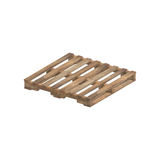](../assets/mgsv-tpp-gntn_pllt002_vrtn001-4009be9852b8f0dd.md) | [Unidentified model (gntn_pllt002_vrtn001)](../assets/mgsv-tpp-gntn_pllt002_vrtn001-4009be9852b8f0dd.md) (unidentified) | gntn_pllt002_vrtn001.fmdl | Native model reference; a readable object identification has not been reviewed. |  | Variant: vrtn001; LOD0; 406 triangles |
| [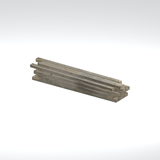](../assets/mgsv-tpp-gntn_tmbr001_tmbr002-dba5931e90b0c03e.md) | [Unidentified model (gntn_tmbr001_tmbr002)](../assets/mgsv-tpp-gntn_tmbr001_tmbr002-dba5931e90b0c03e.md) (unidentified) | gntn_tmbr001_tmbr002.fmdl | Native model reference; a readable object identification has not been reviewed. |  | Variant: No explicit variant token; LOD0; 96 triangles |
| [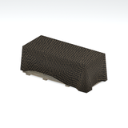](../assets/mgsv-tpp-gntn_wdbx002_vrtn005-e788a59ead7d3c33.md) | [Unidentified model (gntn_wdbx002_vrtn005)](../assets/mgsv-tpp-gntn_wdbx002_vrtn005-e788a59ead7d3c33.md) (unidentified) | gntn_wdbx002_vrtn005.fmdl | Native model reference; a readable object identification has not been reviewed. |  | Variant: vrtn005; LOD0; 77 triangles |
| [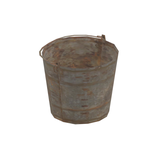](../assets/mgsv-tpp-mafr_bckt001-1b44a950d78b7e59.md) | [Unidentified model (mafr_bckt001)](../assets/mgsv-tpp-mafr_bckt001-1b44a950d78b7e59.md) (unidentified) | mafr_bckt001.fmdl | Native model reference; a readable object identification has not been reviewed. |  | Variant: No explicit variant token; LOD0; 172 triangles |
| [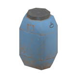](../assets/mgsv-tpp-mafr_bckt003-786816232939ee49.md) | [Unidentified model (mafr_bckt003)](../assets/mgsv-tpp-mafr_bckt003-786816232939ee49.md) (unidentified) | mafr_bckt003.fmdl | Native model reference; a readable object identification has not been reviewed. |  | Variant: No explicit variant token; LOD0; 80 triangles |
| [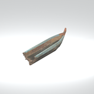](../assets/mgsv-tpp-mafr_boat001_vrtn001-b6c5c652f2c1953b.md) | [Unidentified model (mafr_boat001_vrtn001)](../assets/mgsv-tpp-mafr_boat001_vrtn001-b6c5c652f2c1953b.md) (unidentified) | mafr_boat001_vrtn001.fmdl | Native model reference; a readable object identification has not been reviewed. |  | Variant: vrtn001; LOD0; 374 triangles |
| [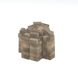](../assets/mgsv-tpp-mafr_brck001-909ee99e4abcbc47.md) | [Unidentified model (mafr_brck001)](../assets/mgsv-tpp-mafr_brck001-909ee99e4abcbc47.md) (unidentified) | mafr_brck001.fmdl | Native model reference; a readable object identification has not been reviewed. |  | Variant: No explicit variant token; LOD0; 366 triangles |
| [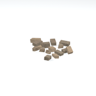](../assets/mgsv-tpp-mafr_brck001_vrtn001-e35d4e72b2bdaa9d.md) | [Unidentified model (mafr_brck001_vrtn001)](../assets/mgsv-tpp-mafr_brck001_vrtn001-e35d4e72b2bdaa9d.md) (unidentified) | mafr_brck001_vrtn001.fmdl | Native model reference; a readable object identification has not been reviewed. |  | Variant: vrtn001; LOD0; 216 triangles |
|  | [Unidentified model (mafr_bttl001_br)](../assets/mgsv-tpp-mafr_bttl001_br-43366cba83af1d01.md) (unidentified) | mafr_bttl001_br.fmdl | Native model reference; a readable object identification has not been reviewed. |  | Variant: No explicit variant token; LOD0; 60 triangles |
| [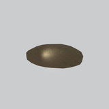](../assets/mgsv-tpp-mafr_clod004_vrtn001-3c8d93c87be772d6.md) | [Unidentified model (mafr_clod004_vrtn001)](../assets/mgsv-tpp-mafr_clod004_vrtn001-3c8d93c87be772d6.md) (unidentified) | mafr_clod004_vrtn001.fmdl | Native model reference; a readable object identification has not been reviewed. |  | Variant: vrtn001; LOD0; 155 triangles |
| [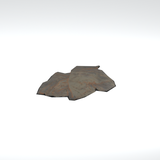](../assets/mgsv-tpp-mafr_clth004-c2db305764a80a20.md) | [Unidentified model (mafr_clth004)](../assets/mgsv-tpp-mafr_clth004-c2db305764a80a20.md) (unidentified) | mafr_clth004.fmdl | Native model reference; a readable object identification has not been reviewed. |  | Variant: No explicit variant token; LOD0; 155 triangles |
| [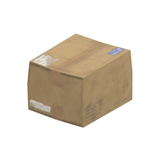](../assets/mgsv-tpp-mafr_crto001-47e1d0ebb2d32923.md) | [Unidentified model (mafr_crto001)](../assets/mgsv-tpp-mafr_crto001-47e1d0ebb2d32923.md) (unidentified) | mafr_crto001.fmdl | Native model reference; a readable object identification has not been reviewed. |  | Variant: No explicit variant token; LOD0; 34 triangles |

Pages: [1](unclassified-components-1.md) | [2](unclassified-components-2.md) | [3](unclassified-components-3.md) | [4](unclassified-components-4.md) | [5](unclassified-components-5.md) | [6](unclassified-components-6.md) | [7](unclassified-components-7.md) | [8](unclassified-components-8.md) | [9](unclassified-components-9.md) | [10](unclassified-components-10.md) | [11](unclassified-components-11.md) | [12](unclassified-components-12.md) | [13](unclassified-components-13.md) | [14](unclassified-components-14.md) | [15](unclassified-components-15.md) | [16](unclassified-components-16.md) | [17](unclassified-components-17.md) | [18](unclassified-components-18.md) | [19](unclassified-components-19.md) | [20](unclassified-components-20.md) | [21](unclassified-components-21.md) | [22](unclassified-components-22.md) | [23](unclassified-components-23.md) | [24](unclassified-components-24.md) | [25](unclassified-components-25.md) | [26](unclassified-components-26.md) | [27](unclassified-components-27.md) | [28](unclassified-components-28.md) | [29](unclassified-components-29.md) | [30](unclassified-components-30.md) | [31](unclassified-components-31.md)
