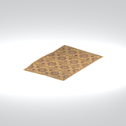
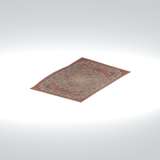
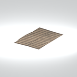
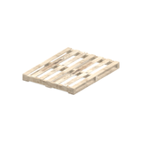
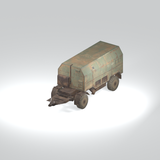
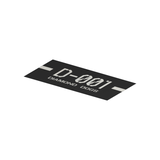

# Unclassified &gt; Unclassified components - page 9

[Library](../README.md) | [Source / advanced data](../catalogue.json) | [Credits](../sources-and-credits.md)

Static thumbnails only. Open a name or preview for its full still and 360-degree camera reference.

| Preview | Name | Game filename | Description | Tags | Variant / LOD |
|---|---|---|---|---|---|
|  | [Unidentified model (afgh_mttr001)](../assets/mgsv-tpp-afgh_mttr001-3c3ac21788872b1f.md) (unidentified) | afgh_mttr001.fmdl | Native model reference; a readable object identification has not been reviewed. |  | Variant: No explicit variant token; LOD0; 25 triangles |
|  | [Unidentified model (afgh_mttr001_vrtn001)](../assets/mgsv-tpp-afgh_mttr001_vrtn001-6a8813b3451195ba.md) (unidentified) | afgh_mttr001_vrtn001.fmdl | Native model reference; a readable object identification has not been reviewed. |  | Variant: vrtn001; LOD0; 22 triangles |
|  | [Unidentified model (afgh_mttr001_vrtn002)](../assets/mgsv-tpp-afgh_mttr001_vrtn002-9bcf7296948eca40.md) (unidentified) | afgh_mttr001_vrtn002.fmdl | Native model reference; a readable object identification has not been reviewed. |  | Variant: vrtn002; LOD0; 25 triangles |
|  | [Unidentified model (afgh_pllt001)](../assets/mgsv-tpp-afgh_pllt001-15e2a054827836e9.md) (unidentified) | afgh_pllt001.fmdl | Native model reference; a readable object identification has not been reviewed. |  | Variant: No explicit variant token; LOD0; 156 triangles |
|  | [Unidentified model (afgh_pstr001_vrtn002)](../assets/mgsv-tpp-afgh_pstr001_vrtn002-884df9f5ecdee5c4.md) (unidentified) | afgh_pstr001_vrtn002.fmdl | Native model reference; a readable object identification has not been reviewed. |  | Variant: vrtn002; LOD0; 6 triangles |
|  | [Unidentified model (afgh_pstr002_vrtn001)](../assets/mgsv-tpp-afgh_pstr002_vrtn001-7fab5351c3f06482.md) (unidentified) | afgh_pstr002_vrtn001.fmdl | Native model reference; a readable object identification has not been reviewed. |  | Variant: vrtn001; LOD0; 2 triangles |
|  | [Unidentified model (afgh_pstr002_vrtn005)](../assets/mgsv-tpp-afgh_pstr002_vrtn005-803ed3396043ad65.md) (unidentified) | afgh_pstr002_vrtn005.fmdl | Native model reference; a readable object identification has not been reviewed. |  | Variant: vrtn005; LOD0; 16 triangles |
|  | [Unidentified model (afgh_pstr002_vrtn006)](../assets/mgsv-tpp-afgh_pstr002_vrtn006-dad41af632877891.md) (unidentified) | afgh_pstr002_vrtn006.fmdl | Native model reference; a readable object identification has not been reviewed. |  | Variant: vrtn006; LOD0; 14 triangles |
|  | [Unidentified model (afgh_sndb003_vrtn001)](../assets/mgsv-tpp-afgh_sndb003_vrtn001-7b0c71e3412a9a4a.md) (unidentified) | afgh_sndb003_vrtn001.fmdl | Native model reference; a readable object identification has not been reviewed. |  | Variant: vrtn001; LOD0; 509 triangles |
|  | [Unidentified model (afgh_sndb004_vrtn001)](../assets/mgsv-tpp-afgh_sndb004_vrtn001-bdc22555283c2141.md) (unidentified) | afgh_sndb004_vrtn001.fmdl | Native model reference; a readable object identification has not been reviewed. |  | Variant: vrtn001; LOD0; 871 triangles |
|  | [Unidentified model (afgh_trck002_trck001)](../assets/mgsv-tpp-afgh_trck002_trck001-ad7330f2b92a7d77.md) (unidentified) | afgh_trck002_trck001.fmdl | Native model reference; a readable object identification has not been reviewed. |  | Variant: No explicit variant token; LOD0; 1548 triangles |
|  | [Unidentified model (cm_mtbs_dc_sign002_vrtn001)](../assets/mgsv-tpp-cm_mtbs_dc_sign002_vrtn001-ead5c71f481c2c51.md) (unidentified) | cm_mtbs_dc_sign002_vrtn001.fmdl | Native model reference; a readable object identification has not been reviewed. |  | Variant: vrtn001; LOD0; 2 triangles |

Pages: [1](unclassified-components-1.md) | [2](unclassified-components-2.md) | [3](unclassified-components-3.md) | [4](unclassified-components-4.md) | [5](unclassified-components-5.md) | [6](unclassified-components-6.md) | [7](unclassified-components-7.md) | [8](unclassified-components-8.md) | [9](unclassified-components-9.md) | [10](unclassified-components-10.md) | [11](unclassified-components-11.md) | [12](unclassified-components-12.md) | [13](unclassified-components-13.md) | [14](unclassified-components-14.md) | [15](unclassified-components-15.md) | [16](unclassified-components-16.md) | [17](unclassified-components-17.md) | [18](unclassified-components-18.md) | [19](unclassified-components-19.md) | [20](unclassified-components-20.md) | [21](unclassified-components-21.md) | [22](unclassified-components-22.md) | [23](unclassified-components-23.md) | [24](unclassified-components-24.md) | [25](unclassified-components-25.md) | [26](unclassified-components-26.md) | [27](unclassified-components-27.md) | [28](unclassified-components-28.md) | [29](unclassified-components-29.md) | [30](unclassified-components-30.md) | [31](unclassified-components-31.md) | [32](unclassified-components-32.md) | [33](unclassified-components-33.md)
