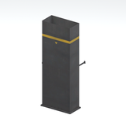

# Architecture &gt; Utility components - page 1

[Library](../README.md) | [Source / advanced data](../catalogue.json) | [Credits](../sources-and-credits.md)

Static thumbnails only. Open a name or preview for its full still and 360-degree camera reference.

| Preview | Name | Game filename | Description | Tags | Variant / LOD |
|---|---|---|---|---|---|
|  | [Duct section](../assets/mgsv-tpp-mtbs_duct002_vrtn001-729a38018dc0.md) | mtbs_duct002_vrtn001.fmdl | A metal duct section with bent connector geometry. This is a static native variant, not an assembled or functional ventilation system. | duct, ventilation, metal, mother-base | Variant: vrtn001; LOD0; 38 triangles |

Pages: [1](utility-components-1.md)
