# Architecture &gt; Wooden platforms - page 1

[Library](../README.md) | [Source / advanced data](../catalogue.json) | [Credits](../sources-and-credits.md)

Static thumbnails only. Open a name or preview for its full still and 360-degree camera reference.

| Preview | Name | Game filename | Description | Tags | Variant / LOD |
|---|---|---|---|---|---|
| [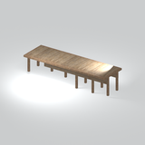](../assets/mgsv-tpp-mgom_base001_vrtn013-25d809b7bfa8034f.md) | [Long wooden platform section](../assets/mgsv-tpp-mgom_base001_vrtn013-25d809b7bfa8034f.md) | mgom_base001_vrtn013.fmdl | A long, open-sided plank platform with rows of support posts underneath. | wood, platform, deck, posts, long-section, mgo | Variant: vrtn013; LOD0; 324 triangles |
| [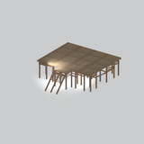](../assets/mgsv-tpp-mgom_base001_vrtn017-16a6f0f245019be8.md) | [Raised wooden platform with stairs](../assets/mgsv-tpp-mgom_base001_vrtn017-16a6f0f245019be8.md) | mgom_base001_vrtn017.fmdl | A broad elevated wooden deck with many slender posts and a stairway at one end. | wood, platform, deck, stairs, posts, mgo | Variant: vrtn017; LOD0; 1246 triangles |
| [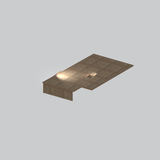](../assets/mgsv-tpp-mgom_base001_vrtn004-351e059ecdea78ba.md) | [Wooden platform and wall section](../assets/mgsv-tpp-mgom_base001_vrtn004-351e059ecdea78ba.md) | mgom_base001_vrtn004.fmdl | An irregular wooden deck section with short vertical plank walls beneath part of its edge. | wood, platform, deck, wall, planks, mgo | Variant: vrtn004; LOD0; 980 triangles |
| [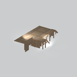](../assets/mgsv-tpp-mgom_base001_vrtn016-038dba72899b46c0.md) | [Wooden platform and wall section](../assets/mgsv-tpp-mgom_base001_vrtn016-038dba72899b46c0.md) | mgom_base001_vrtn016.fmdl | A long plank platform with partial wall panels and supports below its deck. | wood, platform, deck, wall, posts, mgo | Variant: vrtn016; LOD0; 1360 triangles |
| [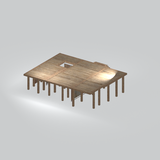](../assets/mgsv-tpp-mgom_base001_vrtn001-3b02f7cb69db29a5.md) | [Wooden platform with floor opening](../assets/mgsv-tpp-mgom_base001_vrtn001-3b02f7cb69db29a5.md) | mgom_base001_vrtn001.fmdl | A raised plank platform on numerous posts, with a small rectangular opening in the deck. | wood, platform, deck, posts, floor-opening, mgo | Variant: vrtn001; LOD0; 1460 triangles |
| [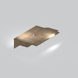](../assets/mgsv-tpp-mgom_base001_vrtn006-273208faf22b7440.md) | [Wooden platform with opening and wall](../assets/mgsv-tpp-mgom_base001_vrtn006-273208faf22b7440.md) | mgom_base001_vrtn006.fmdl | A wooden deck section with a small floor opening and a partial wall along one edge. | wood, platform, deck, floor-opening, wall, mgo | Variant: vrtn006; LOD0; 396 triangles |
| [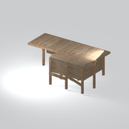](../assets/mgsv-tpp-mgom_base001_vrtn008-586318fa73b1c635.md) | [Wooden platform with partial enclosure](../assets/mgsv-tpp-mgom_base001_vrtn008-586318fa73b1c635.md) | mgom_base001_vrtn008.fmdl | An elevated wooden platform with long posts and a partial plank enclosure beneath one end. | wood, platform, deck, posts, wall, enclosure, mgo | Variant: vrtn008; LOD0; 656 triangles |
| [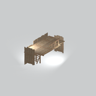](../assets/mgsv-tpp-mgom_base001_vrtn011-40c306de2ff431b1.md) | [Wooden platform with partial walls](../assets/mgsv-tpp-mgom_base001_vrtn011-40c306de2ff431b1.md) | mgom_base001_vrtn011.fmdl | A compact wooden deck section edged by partial plank walls and a small set of steps. | wood, platform, deck, wall, steps, planks, mgo | Variant: vrtn011; LOD0; 1446 triangles |
| [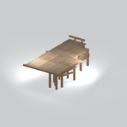](../assets/mgsv-tpp-mgom_base001_vrtn015-1a5682dc04fda478.md) | [Wooden platform with railing](../assets/mgsv-tpp-mgom_base001_vrtn015-1a5682dc04fda478.md) | mgom_base001_vrtn015.fmdl | A raised plank deck section with support posts and a short railing along one end. | wood, platform, deck, railing, posts, mgo | Variant: vrtn015; LOD0; 616 triangles |
| [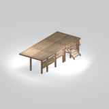](../assets/mgsv-tpp-mgom_base001_vrtn010-cda347ad2b6a5fd6.md) | [Wooden platform with railings and stairs](../assets/mgsv-tpp-mgom_base001_vrtn010-cda347ad2b6a5fd6.md) | mgom_base001_vrtn010.fmdl | A raised wooden deck with partial railings, support posts and a short stairway. | wood, platform, deck, railing, stairs, posts, mgo | Variant: vrtn010; LOD0; 620 triangles |
| [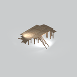](../assets/mgsv-tpp-mgom_base001_vrtn009-a8607d32047da4a7.md) | [Wooden platform with stairs](../assets/mgsv-tpp-mgom_base001_vrtn009-a8607d32047da4a7.md) | mgom_base001_vrtn009.fmdl | An elevated plank platform with a stairway and several support posts. | wood, platform, deck, stairs, posts, mgo | Variant: vrtn009; LOD0; 984 triangles |
| [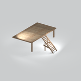](../assets/mgsv-tpp-mgom_base001_vrtn012-3a62e68bc499deaa.md) | [Wooden platform with stairs](../assets/mgsv-tpp-mgom_base001_vrtn012-3a62e68bc499deaa.md) | mgom_base001_vrtn012.fmdl | A rectangular raised plank platform with a projecting stairway and open sides. | wood, platform, deck, stairs, posts, mgo | Variant: vrtn012; LOD0; 424 triangles |

Pages: [1](wooden-platforms-1.md) | [2](wooden-platforms-2.md)
