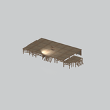
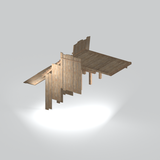

# Architecture &gt; Wooden platforms - page 2

[Library](../README.md) | [Source / advanced data](../catalogue.json) | [Credits](../sources-and-credits.md)

Static thumbnails only. Open a name or preview for its full still and 360-degree camera reference.

| Preview | Name | Game filename | Description | Tags | Variant / LOD |
|---|---|---|---|---|---|
|  | [Wooden platform with steps](../assets/mgsv-tpp-mgom_base001_vrtn002-93517b1b5460eb4e.md) | mgom_base001_vrtn002.fmdl | A broad raised wooden deck with support posts, short steps and partial edge rails. | wood, platform, deck, posts, steps, railing, mgo | Variant: vrtn002; LOD0; 3366 triangles |
|  | [Wooden platform with tall wall panels](../assets/mgsv-tpp-mgom_base001_vrtn014-1529a7ce15567323.md) | mgom_base001_vrtn014.fmdl | A plank platform section with tall vertical wall panels and an adjoining sloped piece. | wood, platform, deck, wall, planks, slope, mgo | Variant: vrtn014; LOD0; 878 triangles |

Pages: [1](wooden-platforms-1.md) | [2](wooden-platforms-2.md)
