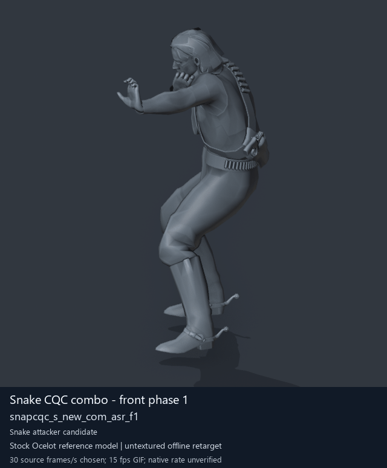

# Pulling CQC combo clips with the real community tools

Evidence date: 15 October 2026. This records offline extraction/cataloguing and later reference-character previews. Source animation payloads and extraction process videos remain private.

## Animated previews

**[View all 25 titled full-character GIFs](gallery.md)**, grouped into Snake CQC clips, NPC receivers and separate special/zombie melee. Each catalogue entry now links to its GIF and thumbnail.

The previews use actual decoded clips on an **untextured stock Ocelot reference character**. They use a chosen preview speed; native timing, paired contact and ordinary-soldier attack behavior remain unverified. Secondary clothing/hair motion is approximate, and no partner or held weapon is shown. See the [full-character recipe](full-character-preview-recipe.md), [media provenance manifest](../../media/animation-previews/2026-10-15/preview-manifest.json) and [persistent preview workflow](../animation-preview-workflow.md).

The extraction findings below remain unchanged. The GIFs are later offline visualization evidence; original `visualConfirmed`/native-playback fields retain their original interpretation limits, with a separate `offlinePreviewConfirmed` field and `preview` links added.

## What was actually done

The real installed GzsTool 0.5.3 and MtarTool 0.2.7 executables ran on fresh copies of three preserved game packages. GzsTool opened each FPK; MtarTool opened the resulting MTAR with its numbered-output option. Twenty-five selected clips were saved with their available companions. All **7,444 extracted payload files** across the three MTARs survived an unchanged repack/unpack with matching canonical member names and SHA-256.

The selection has **11 Snake combo/transition candidates, 8 NPC combo receiver candidates, and 6 separate special/zombie punch candidates**. The NPC combo family is the likely receiving side of Snake's attack, inferred from its names. This work did **not** establish an ordinary Mother Base soldier attacking with an equivalent native combo.

## The pipeline in ordinary language

Think of the game data as boxes inside boxes:

1. **DAT** is one of the game's large storage boxes. GzsTool can open it.
2. **FPK** is a smaller package inside it, such as a player-motion or soldier-common package. GzsTool opens this too.
3. **MTAR** is the animation collection in that package. MtarTool opens it.
4. **GANI** is an individual animation payload. MtarTool also produces an XML index and companion chunks/layout files used to reconstruct a Type 2 archive.

The recorded repeatable run begins with **previously preserved FPK files**. Earlier source receipts identify chunk0.dat and a_chunk7.dat as their origin; this run did not freshly unpack those whole DAT archives. The run freshly performs FPK → MTAR → GANI and companions. No installed game archive, live mod or save was changed.

The actual command forms are:

    & $GzsTool $CopiedPackageFpk
    & $MtarTool $CopiedMotionMtar -n

MtarTool is a command-line community utility. The captured PowerShell window displays real executable invocations, converter output and file checks. The recording wrapper filters the on-screen MTAR output to the first three lines and punch/combo matches; complete unfiltered stdout and stderr are saved separately.

## The source collections

| Source MTAR | Entries | Extracted payload files | Source SHA-256 |
| --- | ---: | ---: | --- |
| player2_cqc | 94 | 274 | e75addc327f7602041f3e309317f5cc580be65189f31350bd9e3c45d1146aa85 |
| player2_resident | 1,285 | 3,345 | 18c4a35c524dcc46f19e712f61a261c94283720a0f119340cecc17eef37fc0d0 |
| Soldier_common | 1,345 | 3,825 | 6f535a29e1c5b6da70514984a47f8a5c988aa468f1d5c87c37f212263dcc001e |

These are the preserved stock inputs, not a later Soldier_common with custom-injected entries.

Snake's likely front-facing attack family is snapcqc_s_new_com_asr_f1 through f5, plus f1_st. Its back-facing family is b1 through b3. The clips span **both** player2_cqc.mtar and player2_resident.mtar; taking only the CQC archive misses part of the family.

Matching NPC names enemasr_s_new_com_asr_f1 through f5 and b1 through b3 occur in Soldier_common.mtar. They are catalogued as **receiver candidates**. Related names and archive membership do not prove visible behavior, transition order, contact, or synchronization.

The independently punch-named enetzmb_s_atk_pnh, pnh2 and pnh_ed are separate NPC candidates. Matching snapzmb names also occur in the player-resident archive. These are kept as special/zombie melee with actor use unverified. They are not evidence of a regular soldier attack combo. The dictionary also contains enetwkg_s_punch and enetwkg_s_punch_short, but they were not found in this bounded stock Soldier_common input; a dictionary name is not an extracted clip.

## Find the saved metadata

- [Full portable JSON catalogue](animations-metadata.json): all 25 exact names, hash IDs, roles, confidence levels, source hashes, frame counts, and per-payload byte lengths/SHA-256.
- [CSV catalogue](animations-metadata.csv): a concise sortable index.
- [Proposed attack/receive phase pairs](phase-table.md) and [machine-readable links](proposed-phase-pairs.json).
- [Entry schema](animation-entry.schema.json).
- [Replay script](Extract-Preserved-Packages.ps1): copied FPK inputs and installed community-tool paths are supplied by the caller.

The phase links are **name-based hypotheses**, not a native paired-action implementation. Frame counts come from the GANI2 mini-header. No frame rate, duration, contact time or engine transition timing was assumed.

## Keep the companions

A clip is not saved as a GANI alone. Preserve matching EXCHNK and ENCHNK when present, the source archive's TRK and CHNK, the original MTAR and tool-generated XML. The XML preserves archive settings and entry paths. The private library includes complete initial extraction trees and convenient selected-clip folders.

Those companion extensions are MtarTool's extracted representations. The wiki explains their roles; this does not mean that the game loads those loose files directly.

## Verification and the failed first audit

The first recorded take extracted successfully, but its first roundtrip audit compared numbered output paths literally. MtarTool changes its numbered prefixes when repacking. Its 274 CQC payloads already matched after stripping those prefixes. That take and its logs are retained as a failed audit, not presented as a successful full run.

The corrected recorded run removes **only** the exact four-digit basename prefix, rejects canonical-name collisions, then compares every canonical member name and SHA-256. All three archives pass. Original numbered manifests remain intact. Roundtrip archive hashes may differ because packing/order changes; the proof is equality of every extracted member.

This establishes converter/data preservation. It does not establish animation quality, rig compatibility, root motion, paired contact, gameplay timing or a functioning NPC behavior. No clips were edited/normalized; no replacement game packs were built for installation, the initial extraction did not include Blender previews, and MGSV was not launched. Later offline previews are documented above.

## Recording and reproducibility

The private handoff contains a genuine uncut recording of the corrected real execution, a shorter captioned derivative made from its actual frames, the earlier failed audit take, exact command receipts, full raw logs and a timestamped transcript. Capturing a single dedicated console window excluded unrelated desktop and audio.

The portable replay was also executed successfully with PowerShell in noninteractive mode against all three preserved inputs: 52.734 seconds, exit code 0, source MTAR hashes matched, and 94/1,285/1,345 entries verified. Each native invocation receives a blank line on stdin; no manual Enter was needed. A standard .NET SHA-256 helper avoids dependence on the Get-FileHash cmdlet, which was absent in the tested child host. Earlier failed replay checks remain in private evidence.

The portable replay accepts the three preserved FPKs, copies installed community tools to a new private runtime folder, copies source packages, records hashes, runs GzsTool and MtarTool, and writes an inventory. The exact successful private script additionally performs the 25-clip selection and complete roundtrip audit. Use a fresh short output path and your own game data; source payloads and tool executables are not bundled here. The JSON catalogue also records executable, DLL and dictionary snapshot hashes; these identify the tested installed tool files without redistributing them.

## Community credits and primary references

- **BobDoleOwndU — MtarTool**: [project](https://github.com/BobDoleOwndU/MtarTool), [command implementation](https://github.com/BobDoleOwndU/MtarTool/blob/042beb1a6e74a375c9a1c5ca4168d740d1d00f85/MtarTool/Program.cs), [name resolver](https://github.com/BobDoleOwndU/MtarTool/blob/042beb1a6e74a375c9a1c5ca4168d740d1d00f85/MtarTool.Core/Utility/NameResolver.cs), source revision 042beb1a6e74a375c9a1c5ca4168d740d1d00f85. Actual release 0.2.7 binary was independently hashed; a source citation does not imply it was rebuilt locally.
- **Atvaark — GzsTool**: [project](https://github.com/Atvaark/GzsTool), [release 0.5.3](https://github.com/Atvaark/GzsTool/releases/tag/v0.5.3). Community contributors and fork authors retain their own authorship.
- **mctrollin — Fox Engine MTAR Tools for Blender**: [project snapshot](https://github.com/mctrollin/fox_engine_mtar_tools_blender/tree/7fa90e589349ad4ba87102f0061a8d8d343a8bf4), [GANI types/mini-header reader](https://github.com/mctrollin/fox_engine_mtar_tools_blender/blob/7fa90e589349ad4ba87102f0061a8d8d343a8bf4/py_fox/fox_gani_types.py), revision 7fa90e589349ad4ba87102f0061a8d8d343a8bf4. The reader informs the frame-count interpretation; the initial extraction did not run its Blender GUI or claim its code as ours. The later preview stage actually used its selected-MTAR importer, example rig and maps in background Blender, as documented in the recipe.
- **MGSV Modding Wiki contributors**: [MtarTool](https://mgsvmoddingwiki.github.io/MtarTool/), [MTAR](https://mgsvmoddingwiki.github.io/MTAR/), [GANI](https://mgsvmoddingwiki.github.io/GANI/), [GzsTool](https://mgsvmoddingwiki.github.io/GzsTool/), [CQC damage notes](https://mgsvmoddingwiki.github.io/Damage_Tables/), read through MGSV MCP at revision 2326cdf753a6fcfefb1867dd66ed97a078d4d114. Damage-category notes do not prove an individual animation filename mapping.
- **TinManTex and lookup-string contributors**: [mgsv-lookup-strings](https://github.com/TinManTex/mgsv-lookup-strings), linked by the wiki as a dictionary resource. This run copied the installed MtarTool dictionary snapshot and saved its hash; it did not claim a fresh lookup-strings revision.

Workflow, cataloguing and explanation were authored with Codex. Community tools and Konami's game assets retain their original authorship.

