# CQC animation GIF gallery

All **25 extracted clips** have a titled full-character GIF and a still thumbnail. The visible character is **stock Ocelot**, used as an untextured reference model. The filename identifies the original Snake/NPC animation source, not Ocelot's own routine.

Three examples are expanded below. Expand another title to see its loop, or open the GIF directly. Clean images and GIFs were saved privately before titles were added.

These are **offline reference-rig previews**. Playback uses a chosen 30 source frames/s, sampled at nominal 15 GIF frames/s; native timing is unmeasured. Hair/clothing/holster secondary motion is approximate. Clips are shown individually without a partner or held weapon. Receiver clips do not establish an ordinary-soldier attacker combo, and phase names alone do not establish unarmed punching. Loop jumps may belong to transitions between separate source clips.

[Catalogue](animations-metadata.json) · [CSV](animations-metadata.csv) · [Preview manifest](../../media/animation-previews/2026-10-15/preview-manifest.json) · [How these were made](full-character-preview-recipe.md) · [Ongoing preview standard](../animation-preview-workflow.md)

Original game models and animations: Konami/Kojima Productions. Community decoding, rig and mappings: mctrollin. Model conversion: FMDL Studio v2/BobDoleOwndU and contributors. See the recipe and [full credits](../../CREDITS.md).

## Snake CQC combo and transition candidates

<strong>Snake CQC combo - front phase 1 end</strong> — <code>snapcqc_s_com_f1_ed</code>

[Open GIF](../../media/animation-previews/2026-10-15/player2_cqc-0079-snapcqc_s_com_f1_ed.gif) · [Still thumbnail](../../media/animation-previews/2026-10-15/player2_cqc-0079-snapcqc_s_com_f1_ed.png)

Source archive: `player2_cqc` · raw frames: 30 · chosen preview duration: 1s

<strong>Snake CQC - left start/miss transition</strong> — <code>snapcqc_s_com_st_mis_l</code>

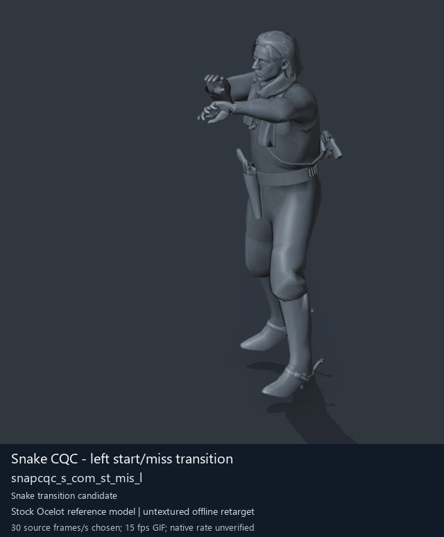

[Open GIF](../../media/animation-previews/2026-10-15/player2_cqc-0080-snapcqc_s_com_st_mis_l.gif) · [Still thumbnail](../../media/animation-previews/2026-10-15/player2_cqc-0080-snapcqc_s_com_st_mis_l.png)

Source archive: `player2_cqc` · raw frames: 75 · chosen preview duration: 2.5s

<strong>Snake CQC combo - back phase 2</strong> — <code>snapcqc_s_new_com_asr_b2</code>

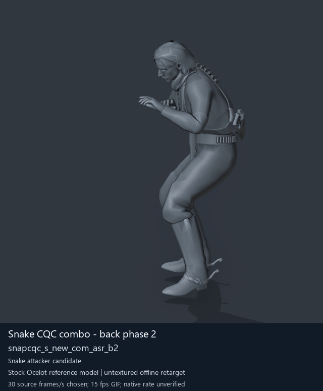

[Open GIF](../../media/animation-previews/2026-10-15/player2_cqc-0084-snapcqc_s_new_com_asr_b2.gif) · [Still thumbnail](../../media/animation-previews/2026-10-15/player2_cqc-0084-snapcqc_s_new_com_asr_b2.png)

Source archive: `player2_cqc` · raw frames: 85 · chosen preview duration: 2.83s

<strong>Snake CQC combo - back phase 3</strong> — <code>snapcqc_s_new_com_asr_b3</code>

[Open GIF](../../media/animation-previews/2026-10-15/player2_cqc-0085-snapcqc_s_new_com_asr_b3.gif) · [Still thumbnail](../../media/animation-previews/2026-10-15/player2_cqc-0085-snapcqc_s_new_com_asr_b3.png)

Source archive: `player2_cqc` · raw frames: 90 · chosen preview duration: 3s

<strong>Snake CQC combo - front phase 1</strong> — <code>snapcqc_s_new_com_asr_f1</code>

[Open GIF](../../media/animation-previews/2026-10-15/player2_cqc-0086-snapcqc_s_new_com_asr_f1.gif) · [Still thumbnail](../../media/animation-previews/2026-10-15/player2_cqc-0086-snapcqc_s_new_com_asr_f1.png)

Source archive: `player2_cqc` · raw frames: 60 · chosen preview duration: 2s

<strong>Snake CQC combo - front phase 2</strong> — <code>snapcqc_s_new_com_asr_f2</code>

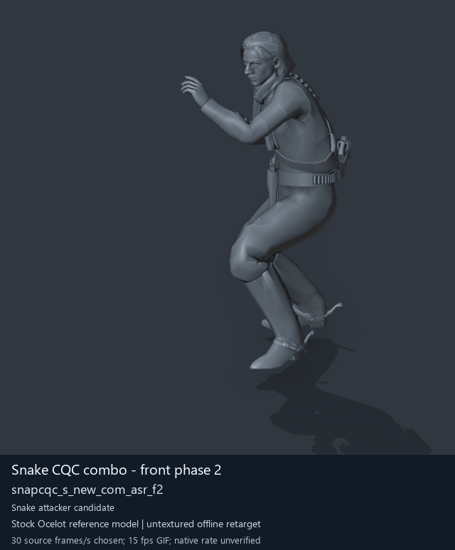

[Open GIF](../../media/animation-previews/2026-10-15/player2_cqc-0087-snapcqc_s_new_com_asr_f2.gif) · [Still thumbnail](../../media/animation-previews/2026-10-15/player2_cqc-0087-snapcqc_s_new_com_asr_f2.png)

Source archive: `player2_cqc` · raw frames: 78 · chosen preview duration: 2.6s

<strong>Snake CQC combo - front phase 3</strong> — <code>snapcqc_s_new_com_asr_f3</code>

[Open GIF](../../media/animation-previews/2026-10-15/player2_cqc-0088-snapcqc_s_new_com_asr_f3.gif) · [Still thumbnail](../../media/animation-previews/2026-10-15/player2_cqc-0088-snapcqc_s_new_com_asr_f3.png)

Source archive: `player2_cqc` · raw frames: 83 · chosen preview duration: 2.77s

<strong>Snake CQC combo - front phase 4</strong> — <code>snapcqc_s_new_com_asr_f4</code>

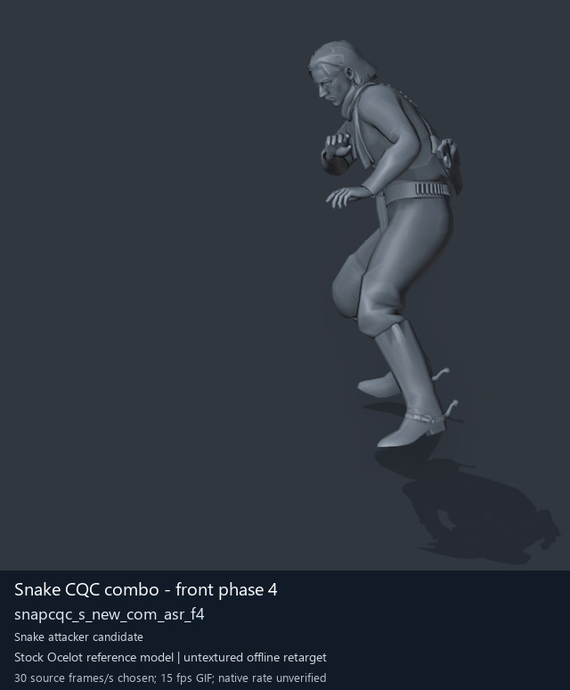

[Open GIF](../../media/animation-previews/2026-10-15/player2_cqc-0089-snapcqc_s_new_com_asr_f4.gif) · [Still thumbnail](../../media/animation-previews/2026-10-15/player2_cqc-0089-snapcqc_s_new_com_asr_f4.png)

Source archive: `player2_cqc` · raw frames: 85 · chosen preview duration: 2.83s

<strong>Snake CQC combo - back phase 1</strong> — <code>snapcqc_s_new_com_asr_b1</code>

[Open GIF](../../media/animation-previews/2026-10-15/player2_resident-0226-snapcqc_s_new_com_asr_b1.gif) · [Still thumbnail](../../media/animation-previews/2026-10-15/player2_resident-0226-snapcqc_s_new_com_asr_b1.png)

Source archive: `player2_resident` · raw frames: 60 · chosen preview duration: 2s

<strong>Snake CQC combo - front phase 1 start</strong> — <code>snapcqc_s_new_com_asr_f1_st</code>

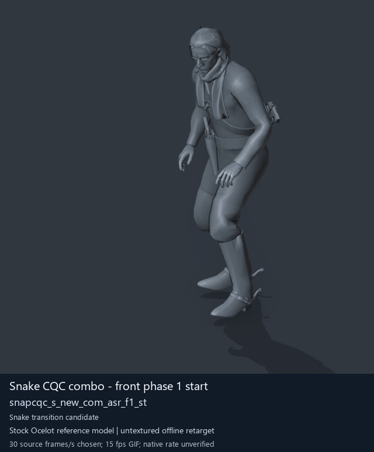

[Open GIF](../../media/animation-previews/2026-10-15/player2_resident-0227-snapcqc_s_new_com_asr_f1_st.gif) · [Still thumbnail](../../media/animation-previews/2026-10-15/player2_resident-0227-snapcqc_s_new_com_asr_f1_st.png)

Source archive: `player2_resident` · raw frames: 25 · chosen preview duration: 0.83s

<strong>Snake CQC combo - front phase 5</strong> — <code>snapcqc_s_new_com_asr_f5</code>

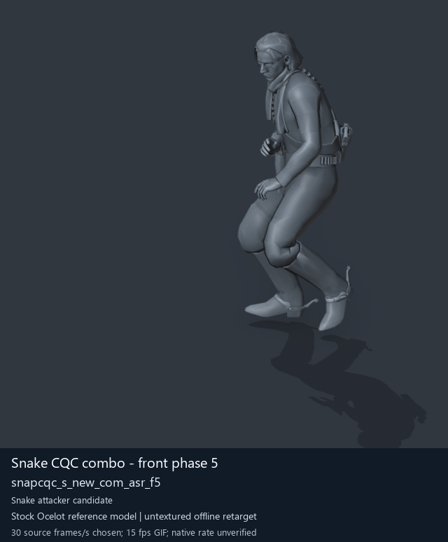

[Open GIF](../../media/animation-previews/2026-10-15/player2_resident-0228-snapcqc_s_new_com_asr_f5.gif) · [Still thumbnail](../../media/animation-previews/2026-10-15/player2_resident-0228-snapcqc_s_new_com_asr_f5.png)

Source archive: `player2_resident` · raw frames: 105 · chosen preview duration: 3.5s

## NPC combo receiver candidates

<strong>NPC combo receiver - back phase 1</strong> — <code>enemasr_s_new_com_asr_b1</code>

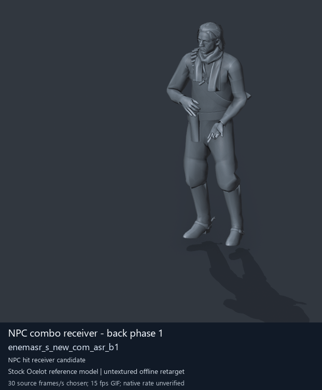

[Open GIF](../../media/animation-previews/2026-10-15/Soldier_common-0114-enemasr_s_new_com_asr_b1.gif) · [Still thumbnail](../../media/animation-previews/2026-10-15/Soldier_common-0114-enemasr_s_new_com_asr_b1.png)

Source archive: `Soldier_common` · raw frames: 87 · chosen preview duration: 2.9s

<strong>NPC combo receiver - back phase 2</strong> — <code>enemasr_s_new_com_asr_b2</code>

[Open GIF](../../media/animation-previews/2026-10-15/Soldier_common-0115-enemasr_s_new_com_asr_b2.gif) · [Still thumbnail](../../media/animation-previews/2026-10-15/Soldier_common-0115-enemasr_s_new_com_asr_b2.png)

Source archive: `Soldier_common` · raw frames: 98 · chosen preview duration: 3.27s

<strong>NPC combo receiver - back phase 3</strong> — <code>enemasr_s_new_com_asr_b3</code>

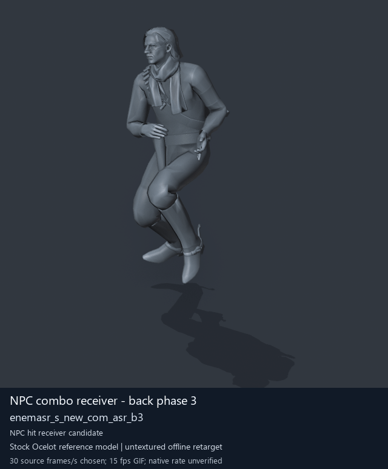

[Open GIF](../../media/animation-previews/2026-10-15/Soldier_common-0116-enemasr_s_new_com_asr_b3.gif) · [Still thumbnail](../../media/animation-previews/2026-10-15/Soldier_common-0116-enemasr_s_new_com_asr_b3.png)

Source archive: `Soldier_common` · raw frames: 120 · chosen preview duration: 4s

<strong>NPC combo receiver - front phase 1</strong> — <code>enemasr_s_new_com_asr_f1</code>

[Open GIF](../../media/animation-previews/2026-10-15/Soldier_common-0117-enemasr_s_new_com_asr_f1.gif) · [Still thumbnail](../../media/animation-previews/2026-10-15/Soldier_common-0117-enemasr_s_new_com_asr_f1.png)

Source archive: `Soldier_common` · raw frames: 65 · chosen preview duration: 2.17s

<strong>NPC combo receiver - front phase 2</strong> — <code>enemasr_s_new_com_asr_f2</code>

[Open GIF](../../media/animation-previews/2026-10-15/Soldier_common-0118-enemasr_s_new_com_asr_f2.gif) · [Still thumbnail](../../media/animation-previews/2026-10-15/Soldier_common-0118-enemasr_s_new_com_asr_f2.png)

Source archive: `Soldier_common` · raw frames: 90 · chosen preview duration: 3s

<strong>NPC combo receiver - front phase 3</strong> — <code>enemasr_s_new_com_asr_f3</code>

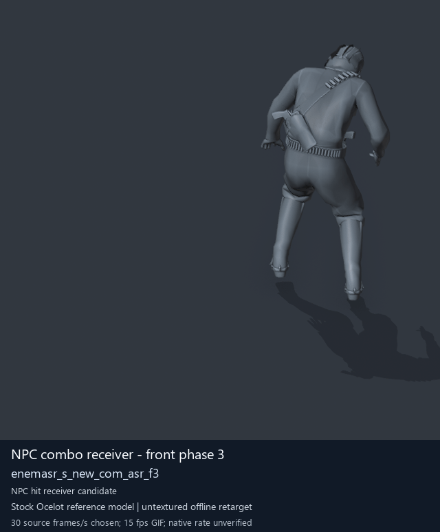

[Open GIF](../../media/animation-previews/2026-10-15/Soldier_common-0119-enemasr_s_new_com_asr_f3.gif) · [Still thumbnail](../../media/animation-previews/2026-10-15/Soldier_common-0119-enemasr_s_new_com_asr_f3.png)

Source archive: `Soldier_common` · raw frames: 100 · chosen preview duration: 3.33s

<strong>NPC combo receiver - front phase 4</strong> — <code>enemasr_s_new_com_asr_f4</code>

[Open GIF](../../media/animation-previews/2026-10-15/Soldier_common-0120-enemasr_s_new_com_asr_f4.gif) · [Still thumbnail](../../media/animation-previews/2026-10-15/Soldier_common-0120-enemasr_s_new_com_asr_f4.png)

Source archive: `Soldier_common` · raw frames: 93 · chosen preview duration: 3.1s

<strong>NPC combo receiver - front phase 5</strong> — <code>enemasr_s_new_com_asr_f5</code>

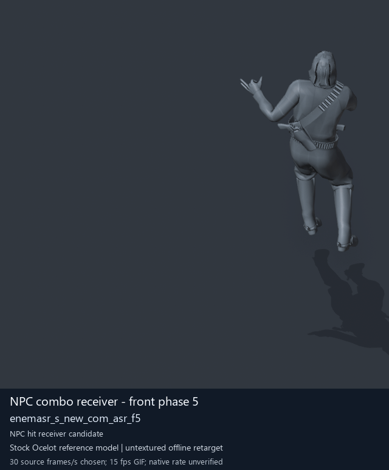

[Open GIF](../../media/animation-previews/2026-10-15/Soldier_common-0121-enemasr_s_new_com_asr_f5.gif) · [Still thumbnail](../../media/animation-previews/2026-10-15/Soldier_common-0121-enemasr_s_new_com_asr_f5.png)

Source archive: `Soldier_common` · raw frames: 135 · chosen preview duration: 4.5s

## Separate special/zombie melee candidates

<strong>Special/zombie punch - player phase 1</strong> — <code>snapzmb_s_atk_pnh</code>

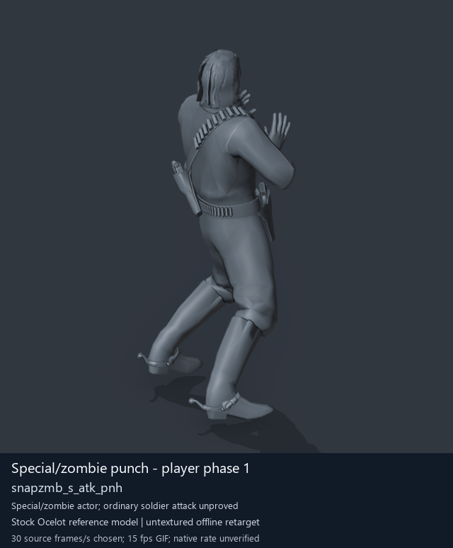

[Open GIF](../../media/animation-previews/2026-10-15/player2_resident-1280-snapzmb_s_atk_pnh.gif) · [Still thumbnail](../../media/animation-previews/2026-10-15/player2_resident-1280-snapzmb_s_atk_pnh.png)

Source archive: `player2_resident` · raw frames: 60 · chosen preview duration: 2s

<strong>Special/zombie punch - player phase 2</strong> — <code>snapzmb_s_atk_pnh2</code>

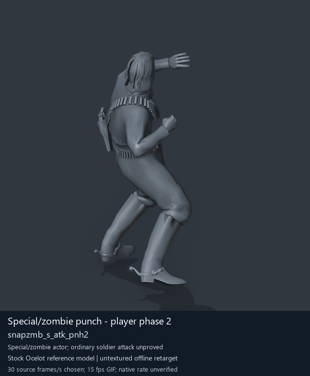

[Open GIF](../../media/animation-previews/2026-10-15/player2_resident-1281-snapzmb_s_atk_pnh2.gif) · [Still thumbnail](../../media/animation-previews/2026-10-15/player2_resident-1281-snapzmb_s_atk_pnh2.png)

Source archive: `player2_resident` · raw frames: 43 · chosen preview duration: 1.43s

<strong>Special/zombie punch - player ending</strong> — <code>snapzmb_s_atk_pnh_ed</code>

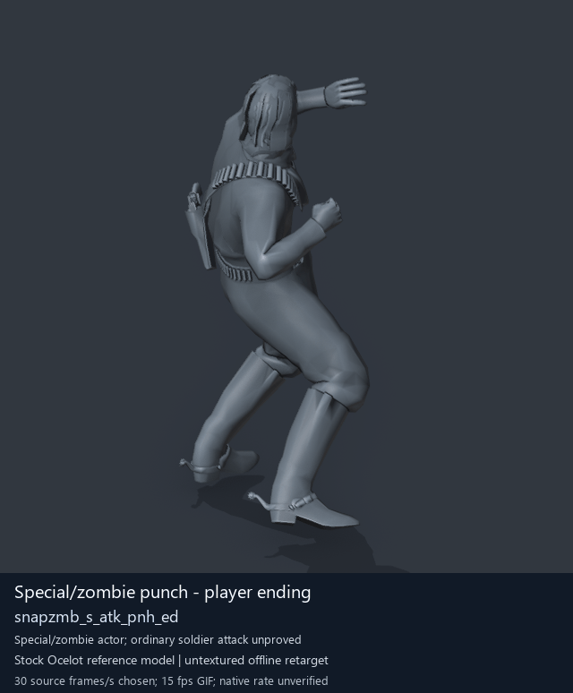

[Open GIF](../../media/animation-previews/2026-10-15/player2_resident-1282-snapzmb_s_atk_pnh_ed.gif) · [Still thumbnail](../../media/animation-previews/2026-10-15/player2_resident-1282-snapzmb_s_atk_pnh_ed.png)

Source archive: `player2_resident` · raw frames: 15 · chosen preview duration: 0.5s

<strong>Special/zombie punch - enemy phase 1</strong> — <code>enetzmb_s_atk_pnh</code>

[Open GIF](../../media/animation-previews/2026-10-15/Soldier_common-1311-enetzmb_s_atk_pnh.gif) · [Still thumbnail](../../media/animation-previews/2026-10-15/Soldier_common-1311-enetzmb_s_atk_pnh.png)

Source archive: `Soldier_common` · raw frames: 60 · chosen preview duration: 2s

<strong>Special/zombie punch - enemy phase 2</strong> — <code>enetzmb_s_atk_pnh2</code>

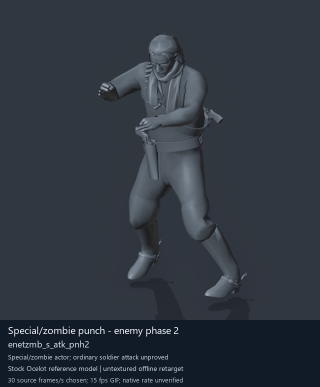

[Open GIF](../../media/animation-previews/2026-10-15/Soldier_common-1312-enetzmb_s_atk_pnh2.gif) · [Still thumbnail](../../media/animation-previews/2026-10-15/Soldier_common-1312-enetzmb_s_atk_pnh2.png)

Source archive: `Soldier_common` · raw frames: 43 · chosen preview duration: 1.43s

<strong>Special/zombie punch - enemy ending</strong> — <code>enetzmb_s_atk_pnh_ed</code>

[Open GIF](../../media/animation-previews/2026-10-15/Soldier_common-1313-enetzmb_s_atk_pnh_ed.gif) · [Still thumbnail](../../media/animation-previews/2026-10-15/Soldier_common-1313-enetzmb_s_atk_pnh_ed.png)

Source archive: `Soldier_common` · raw frames: 15 · chosen preview duration: 0.5s

