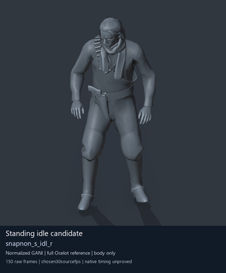

# Experimental unarmed idle reference — still alternative

This page loads one reviewed PNG and no GIFs. It shows the adapted `snapnon_s_idl_r` reference on the full untextured stock Ocelot mesh. This is a relaxed rest candidate with offline visual evidence only, not a native Soldier2 demonstration or a working training fix.

[Animated detail — one GIF](unarmed-idle.md) | [Metadata, source identity and credits](unarmed-idle-preview.json) | [Training and staff research](README.md)
