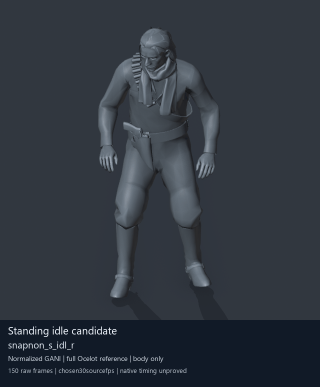

# Experimental adapted reference: relaxed unarmed standing idle

`snapnon_s_idl_r` from `player2_resident`, shown on a complete untextured stock Ocelot reference mesh. This is **offline visual evidence only**, not a working training fix. The source is a Snake/player-family motion; the displayed Ocelot mesh does not identify its source actor.

The hands rest at the sides with subtle chest/hand sway and planted feet. The reviewed full-cycle and seam views support a relaxed rest interpretation; this is not a raised-fist guard. The preview uses 150 raw frames, a chosen 30 source frames/s and 15 GIF frames/s, lasting 5 seconds. Native timing remains unmeasured.

This adapted reference converts one root-vector segment from 32-bit to 16-bit precision and preserves the other 55 segment payloads. Ordered bindings match a retained Soldier layout, but native Soldier2 playback, transition duration, motion completion, ownership and looping are unproved. Eighteen secondary bones use ancestor fallbacks on the community reference rig; native FOX cloth, twist and physics are not reproduced. A closely matching offline seam is not native loop proof.

Two earlier native idle-transition probes produced an inappropriate empty-hand rifle-ready posture and were rejected and rolled back. This preview is a different source-only candidate. Automatic training remains off; no native gameplay fix is accepted by this research update.

[Still alternative — no GIF](unarmed-idle-still.md) | [Preview metadata and hashes](unarmed-idle-preview.json) | [Training and staff research](README.md) | [Existing animation library](../animation-library/README.md)

Original assets and animation: **Konami / Kojima Productions and their rights holders**. Community tooling: **mctrollin / fox_engine_mtar_tools_blender**, **BobDoleOwndU / MtarTool and FMDL Studio v2**, **Atvaark / GzsTool**, **Blender Foundation** and **Pillow contributors**. Authored research and curation use OpenAI Codex under arsenal-pt's direction. See [credits](../../CREDITS.md) and [license scope](../../LICENSE-SCOPE.md). Rendered media does not relicense original game content; source animation payloads, rigs and scenes remain private.
